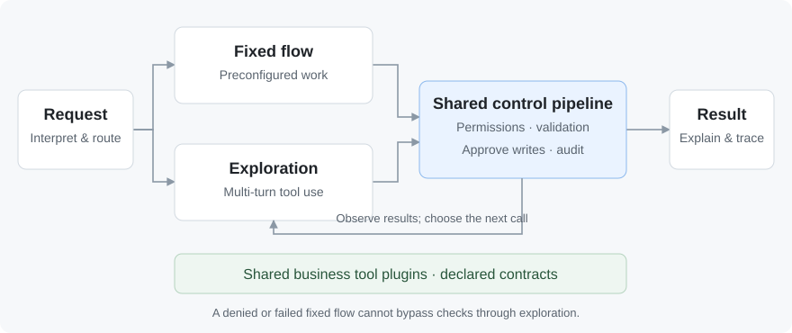
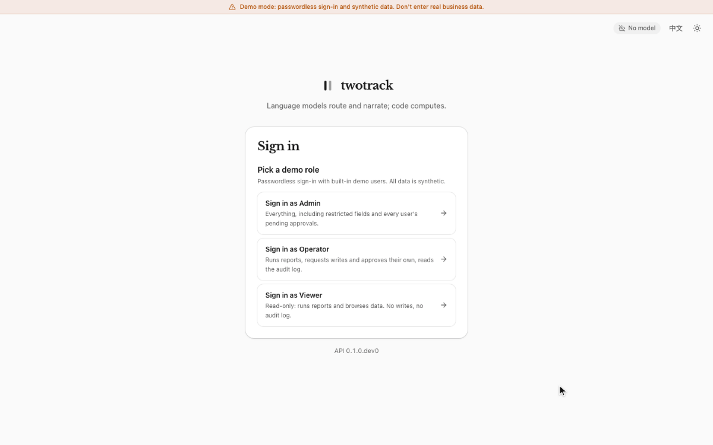

# Agent2B

**A plugin-based enterprise agent architecture reference built around data safety and result accuracy.**

Agent2B brings preconfigured workflows and bounded, multi-turn tool use into one execution and control pipeline. Models interpret requests, orchestrate tools and explain results. Code owns computation, permissions and execution; people approve writes. Business tools connect as plugins, with a supply-chain console showing the architecture in action.

[](https://github.com/wangxuzhou666-arch/Agent2B/actions/workflows/ci.yml)
[](LICENSE)

English | [简体中文](README.zh-CN.md)

## Who it is for

- **Enterprise application developers:** add a natural-language entry point to business systems, reusing authorization, approvals and audit trails.
- **Data and business platform teams:** compute inventory or order metrics in code, let a model explain them, and keep people in control of writes.
- **Teams building agent workflows:** start with a working console, tool plugins and two execution paths instead of assembling the foundations from scratch.

**v0.1.0rc1 is an architecture reference.** It includes synthetic data and extension guides. Real deployments still need your business tools, permission configuration and deployment validation.

## Core workflow: two task paths, one control pipeline

Inventory totals, order filters and permission decisions need repeatable, verifiable results, so deterministic code owns them. Models interpret questions, select tools and explain results. For open questions such as “What do these delays put at risk, and what should we do?”, a model can plan several calls within the same execution controls.



| Track | What happens |
|---|---|
| **Fixed flows: preconfigured work** | Define tools, steps and business rules ahead of time → match the request to an existing flow → execute queries and calculations in code → return results. |
| **Bounded exploration: multi-turn tool use** | Explicitly hand over an uncovered request → select an allowed tool → observe its result → choose the next call or finish. Every round uses the shared pipeline; a denied or failed fixed flow cannot escape into exploration. |

**The shared pipeline is the core of the architecture.** Both paths use the same authorization, argument and output validation, write approvals and audit controls, as well as one tool plugin contract.

**The harness bounds multi-turn tool use.** The host filters tools, validates arguments, bounds turns, calls and time, and records the run. Exploration can only propose a write. Approval is bound to the user, operation and arguments; the model never receives the grant, and execution waits for approval. [Architecture](docs/ARCHITECTURE.md)

## Data safety and result accuracy

**Accuracy starts with execution.** Code queries, filters and computes; the model explains the results. Numeric checks reject unsupported figures within the formats they recognize. A model can still choose the wrong arguments or misinterpret a result, so sources, execution traces and write confirmations remain available for review.

**Data safety starts with limiting what the model sees:**

- **Send less.** The console and exploration send aggregates, row counts, column names and tool text—not row data. The model still receives the scrubbed question, necessary tool definitions and result text.
- **Scrub before sending.** Current values of fields marked as restricted text are matched and replaced with `[REDACTED]`. If those values cannot be loaded, the model call stops. Length and matching limits apply; this does not discover every kind of sensitive information.
- **Separate data from instructions.** Free text in tool results is fenced as untrusted content to reduce injection risk. Host code enforces permissions and approvals. External tools exposed to exploration also require deployment opt-in and approval for each call.

**Know the limits:** aggregates, identifiers and tool text may still be sensitive. Fences do not eliminate injection, and the worker has no network isolation. Review plugin outputs, choose a trusted model endpoint and restrict network egress for real deployments. Opting into MCP `--rows` expands what the client's model sees. See [security boundaries](SECURITY.md) and [MCP](docs/MCP.md).

## One-command demo

Install Git, Docker Compose and `make`, start Docker, then run:

```sh
git clone https://github.com/wangxuzhou666-arch/Agent2B.git && cd Agent2B && make up
```

Open **http://localhost:3000** and choose **Operator**. The first start builds the images and seeds synthetic data. **No model API key is required.**

1. Ask **“How many shipments are late?”** Inspect the computed answer, source and execution trace.
2. Ask **“Create a purchase order for 200 units of SKU-10042”**. Inspect the approval card. Nothing is written until you approve; then open Audit to see the record.



The default uses a **mock model and template answers**. This exact open-ended request runs a scripted exploration case with several tool calls and a write approval; other free-form questions do not receive real-model reasoning:

```text
Several orders from SUP-001 are slipping, SKU-10053 among them. Work out what that puts at risk and propose what to do.
```

Use the wording as shown. [Evidence and walkthrough](docs/EVIDENCE.md) distinguish the verified execution path from real-model effectiveness, which has not yet been evaluated.

<details>
<summary>Stop, check or connect a model</summary>

- `make down`: stop the containers and retain the data volumes.
- `make smoke`: check the running demo; requires Python 3.
- Without `make`: run `docker compose up -d --build --wait` inside the repository.
- To connect a compatible model endpoint, configure `TWOTRACK_PROVIDER=openai_compat`, `TWOTRACK_LLM_MODEL` and `TWOTRACK_LLM_BASE_URL`. Supply `TWOTRACK_LLM_API_KEY` through a local environment or secret manager when authentication is required. See [container configuration](docker-compose.yml) and [exploration settings](docs/ARCHITECTURE.md#exploration). Never commit credentials.

Demo mode allows password-free sign-in and binds ports to localhost. Do not expose it directly to the internet. Decide which data may leave your deployment before connecting a model.

</details>

## Plugin extensions and community

Package a business capability as a tool plugin. Declare its arguments, outputs, approval requirement and whether exploration may call it. Registered tools can serve fixed flows; explicitly explorable tools may also serve multi-turn requests when the user is authorized. The core owns permissions: a plugin cannot grant a role extra write access.

Use cases, reproducible bug reports and focused PRs are welcome. Good starting points:

- [Add a business tool](docs/ADD_A_TOOL.md) that uses the shared permissions, approvals and audit pipeline.
- [Add an entity type](docs/ADD_A_CATEGORY.md) to extend imports and queries through declarations.
- [Improve examples, documentation or regression cases](CONTRIBUTING.md) to help the next contributor get started.

For larger changes, describe the use case and expected outcome in [Issues](https://github.com/wangxuzhou666-arch/Agent2B/issues) first. Use synthetic data in reports; do not attach business records or credentials. Report vulnerabilities privately as described in [SECURITY.md](SECURITY.md).

[Contributing](CONTRIBUTING.md) · [Roadmap](ROADMAP.md) · [Design decisions](docs/decisions/README.md)

## Verification and license

Automated checks cover the backend, frontend, browser flows, tool boundaries and Docker demo. The default demo verifies the execution path, not real-model effectiveness; numeric checks do not guarantee semantic correctness. [Evidence](docs/EVIDENCE.md) · [Known limits](SECURITY.md#known-limits)

[Apache-2.0](LICENSE) · [Third-party notices](NOTICE)
