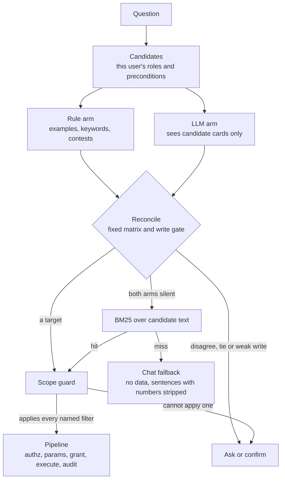
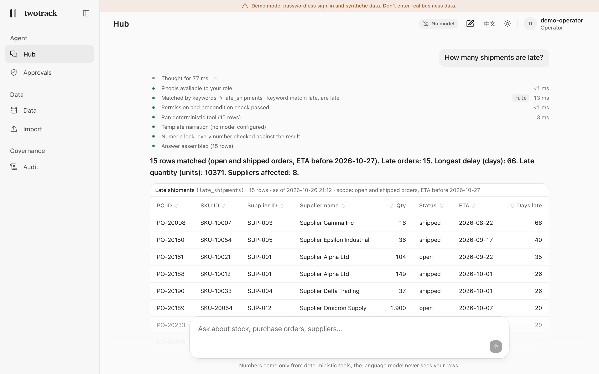

# twotrack

**LLMs route and narrate; code computes.** twotrack is a standalone, runnable architecture baseline for enterprise tasks, built on two tracks:

1. **Fixed flows.** LangGraph routes a question to a registered tool or workflow. Deterministic code owns the numbers, the permissions, the validation and every irreversible effect.
2. **Exploration.** Open-ended analysis that no fixed flow covers runs in [Pi](https://www.npmjs.com/package/@earendil-works/pi-agent-core) (`@earendil-works/pi-agent-core`, pinned to 1.2.0) inside a restricted Node worker. Pi can call only the tools the host exposes, and every call goes back through the same gate: authorization, preconditions, validation, grant, execute, audit. A write is only ever a proposal, and it pauses for a one-time, parameter-bound human approval.

Both tracks share plugins and one permission and audit contract. The demo is a synthetic supply-chain console in which tools compute the figures, the digits in a model's text are checked against them, the model is shown aggregates rather than rows, and it never writes on its own say-so.

[](https://github.com/wangxuzhou666-arch/twotrack/actions/workflows/ci.yml)
[](LICENSE)
[](pyproject.toml)

English | [简体中文](README.zh-CN.md)


## The problem, and the answer

An agent that lets a model compute numbers will sometimes show a wrong one, and a wrong number looks exactly like data. Handing the model the table does not help: it filters, adds and estimates in its own text, and every figure becomes model arithmetic. twotrack divides the work:

- **The model routes and narrates.** It may pick which tool answers a question, propose that tool's parameters and describe the result in words; code validates the parameters. In exploration it also plans which exposed tools to call, and every call goes through the same gate.
- **Deterministic tools compute the figures.** A tool returns aggregates and rows. In the console and in both exploration runtimes the model sees the aggregates, the row count, the column names and the `message` and `scope` text the tool writes, never the rows. That text can carry identifiers a tool chooses to report: the documented exploration case passes `SUP-007` through the supplier scorecard's message. `twotrack mcp --rows` is the opt-in that sends up to 50 rows to an MCP client's model ([docs/MCP.md](docs/MCP.md)).
- **A numeric lock checks the narration.** A sentence that cites a number the result does not back is removed; if nothing survives, a template built from the result answers. The lock reads numerals, not words: a number spelled out in English ("three") is not caught, and neither are bare years, ordinals, dates or identifiers ([SECURITY.md](SECURITY.md#what-the-model-sees-and-what-an-injected-instruction-can-do)).
- **Every write waits for a one-time human approval**, bound to who asked, what runs and with which parameters.
- **Runs, approvals and refusals are traced and audited.** Pipeline runs, imports and approval decisions are written to the audit log, and so are the calls that exploration refuses before the pipeline. A write and its audit record commit together, and the Audit window replays the decision. Some events leave no record and some records are best effort; [SECURITY.md](SECURITY.md#audit-what-fails-closed-what-does-not) lists them.

## Quick start

### With Docker, no API key

```sh
make up        # builds the API and the console, then prints the console URL: http://localhost:3000
make smoke     # checks the running stack: no key, no model (what it checks is below)
make down      # stops it and keeps the data volume
```

This starts **demo mode**: you sign in without a password as one of three built-in demo users (Admin, Operator, Viewer; you pick on the login page), a synthetic supply chain is seeded on first start, and the built-in mock model answers, so every answer is a template and the header says "No model". The cold-chain example plugin is loaded, so the Data window shows a "Cold-Chain Item" tab that no core code declares. Both ports are published on 127.0.0.1 only; keep it that way, because anyone who can reach a demo-mode API can sign in as an admin ([SECURITY.md](SECURITY.md)).

A question that no report covers takes the exploration track: it runs in the real Pi worker, against the repository's mock model. The mock plans nothing and says that no model is configured, with one exception: for the one request worded as `EXPLORATION_CASE` in [`mock_script.py`](src/twotrack/providers/mock_script.py) it follows a fixed script (three reads, then a purchase-order proposal that waits for approval; the wording and the walk-through are in [docs/EVIDENCE.md](docs/EVIDENCE.md)). That script is a demo of the plumbing, not model capability: it shows that the runtime, its restrictions and the gate work together end to end, and nothing about how well any model explores.

`make smoke` needs only python3. It signs in as the demo operator, asks one question a fixed flow answers and one that no fixed flow covers, and checks that the fixed flow left an audit record and did not touch the explorer, and that the second went to the exploration branch, ran in Pi against the mock model (its trace says runtime `pi`, model `mock`), ended normally and produced an answer with no failed model call. It exits 0 only if every check passed.

Sign in as Operator and try these (the console offers the first and the third as starter chips). Each was run against this code, and the Chinese phrasing behaves the same way.

| Ask (English / 中文) | What you see |
|---|---|
| `How many shipments are late?`<br>`哪些采购单逾期了？` | **A direct answer.** The rule arm routes to `late_shipments`. The trace, a source line and the table come with it; every figure is an aggregate the tool computed. |
| `How many late purchase orders are for class A SKUs?`<br>`有多少 A 类物料的逾期采购单？` | **A clarification.** The late-shipments report cannot filter by criticality, so the console asks instead of answering with the unfiltered figure. It offers "Show all criticalities", labelled as unfiltered, and the reports that can apply the filter ([ADR 0004](docs/decisions/0004-scope-guard.md)). |
| `Create a purchase order for 200 units of SKU-10042`<br>`给 SKU-10042 下单 200 件` | **An approval card.** The request is complete, so it goes straight to a one-time grant that lasts 15 minutes. Nothing is written until you press Approve; Audit then shows `needs_confirmation`, `started`, `ok` as one chain ([ADR 0005](docs/decisions/0005-one-time-write-grants.md)). |
| `Create a purchase order` | **Confirm first.** Required parameters are missing, so routing asks you to confirm the target before anything else happens. |

To see the exploration track, sign in as Operator (a Viewer is never offered the write) and send the one request the mock follows a script for:

```text
Several orders from SUP-001 are slipping, SKU-10053 among them. Work out what that puts at risk and propose what to do.
```

No report covers it, so Pi runs it. The mock's script has it make three reads through the gate and then propose a purchase order, which waits in an approval card; nothing is written until you press Approve. Type it as shown: the script matches these words (letter case, extra spaces and the final full stop do not matter, and only the `SUP-` and `SKU-` numbers may differ; with ids that have nothing late, the script stops after its first read), and any other wording is not scripted, so if it reaches exploration the mock answers that no model is configured. This demonstrates the plumbing, not a model planning ([docs/EVIDENCE.md](docs/EVIDENCE.md) has the walk-through and what each case proves).

No Docker? `uv run twotrack demo` runs a walkthrough of its own in one process on a temporary database and exits 1 if any guarantee it demonstrates does not hold, an invented figure reaching an answer among them. Its numeric-lock step, trimmed:

```text
[lock] how many units are on hand in WH-EAST   (the mock is told to invent 31337)
  mock draft   120 rows matched (Warehouse: WH-EAST). Units on hand: 107149. … Next period should come in around 31337.
  after lock   120 rows matched (Warehouse: WH-EAST). Units on hand: 107149. …
  numeric lock removed 1 sentence: "Next period should come in around 31337."
```

### With a local model

```sh
make up-ollama   # the same stack plus Ollama; the first run downloads the model (qwen2.5:0.5b by default)
```

Be realistic about it. The bundled 0.5B model only shows that the wiring works, and the compose file raises the model timeouts (`TWOTRACK_LLM_TIMEOUT_SECONDS`, `TWOTRACK_LLM_ROUTE_TIMEOUT_SECONDS`) for a model on a CPU. When a call outlasts its timeout the question is still answered, by rules and the template, and the answer says the model failed (see [Models](#models)). For a useful local model, set `OLLAMA_MODEL` to a larger one, or run Ollama natively on the host and point `TWOTRACK_LLM_BASE_URL` at it; [docker-compose.yml](docker-compose.yml) explains both.

### With a real model

Any OpenAI-compatible endpoint works. With Docker, set the variables in a `.env` file next to `docker-compose.yml` (every name is in [.env.example](.env.example)); a key goes in a `docker-compose.override.yml` that sets `TWOTRACK_LLM_API_KEY` on the `api` service, because the compose file passes none through. Without Docker, export them before `uv run twotrack serve`.

```sh
TWOTRACK_PROVIDER=openai_compat
TWOTRACK_LLM_BASE_URL=https://your-endpoint.example/v1   # also needed when exploration runs in Pi
TWOTRACK_LLM_MODEL=your-model-name
TWOTRACK_LLM_API_KEY=...                                  # optional for local endpoints
```

For Claude, use Anthropic's OpenAI-compatible endpoint. Some models reject a non-default temperature; set TWOTRACK_LLM_TEMPERATURE=omit to leave it out of requests. twotrack's own calls (routing, narration, chat and the built-in explorer's agent step) otherwise send one. The Pi worker sends no temperature at all, so exploration in Pi needs nothing extra. A half-configured provider stops the API at start-up, and a failed model call is reported in the answer, never hidden (see [Models](#models)).

### For development

```sh
uv sync
TWOTRACK_DEMO_MODE=1 TWOTRACK_CORS_ORIGINS=http://localhost:3000 uv run twotrack serve   # API on 127.0.0.1:8000
cd web && pnpm install --frozen-lockfile && pnpm dev                                      # console on localhost:3000
```

Python 3.11 or newer, Node 24 and pnpm 10. Checks, the end-to-end suite and the rules for changing the router are in [CONTRIBUTING.md](CONTRIBUTING.md). No test needs a model key. To run exploration in Pi locally, install the worker once (`cd harness/pi && npm ci --ignore-scripts`, Node 22.19 or newer) and start the API with `TWOTRACK_ALLOW_OPEN_TASK=1 TWOTRACK_EXPLORER=pi`; [CONTRIBUTING.md](CONTRIBUTING.md) has the details.

Manage existing accounts with `twotrack users disable / enable / roles / passwd`. Demo mode validates the Host header; configure `TWOTRACK_ALLOWED_HOSTS` when using a proxy host name. See [security boundaries](SECURITY.md) for token lifetime and upload limits.

## How it works

`decide_route` is the one place that decides what a question runs. Everything after it goes through one pipeline, so authorization, parameter validation, write grants and audit are not optional per tool.



An explicit target skips both arms but not the candidate gate. Exploration, when it is on (`TWOTRACK_ALLOW_OPEN_TASK`), takes the question that both arms and BM25 leave unplaced, before the chat fallback. [ARCHITECTURE.md](docs/ARCHITECTURE.md) has the read path, the write path and the module map.

**The exploration track** is planned by an agent loop: Pi in a restricted Node worker (`TWOTRACK_EXPLORER=pi`, which the Docker stack fixes) or the built-in loop (the default without Docker; no Node needed). Either way:

- **Only explicitly allowed tools are exposed.** A tool is offered to the model only if its plugin declares it explorable, the user's roles may run it, its preconditions hold and the deployment's allowlist `TWOTRACK_EXPLORE_TOOLS` admits it (unset, it admits every explorable tool except external ones). A call that sends data out of the deployment is offered only when named there, and each of its calls still waits for approval.
- **Every call goes back through the same gate**: authorization, preconditions, validation, grant, execute, audit. The model sees only the narrator view of each result (aggregates, never rows), and the two free-text fields in it, `message` and `scope`, arrive inside an untrusted-content fence (they can carry identifiers a tool chooses to report).
- **A write is a proposal.** It stops the run at the usual one-time grant, and nothing executes until the requester approves it.
- **Exploration is a hand-over, not a second try.** It starts only for a question the router handed over, and a guard refuses a request that named an explicit target or already reached an outcome on a fixed path.
- **Refusals are recorded.** A call refused before the pipeline (an unknown or unexposed tool, unusable arguments, a spent budget) is traced and audited, in both runtimes; if the record cannot be written, the run stops.
- **Runs are budgeted, in both runtimes.** Model turns (`TWOTRACK_EXPLORE_MAX_TURNS`, default 4), tool calls the model asks for, refused ones included (`TWOTRACK_EXPLORE_MAX_CALLS`, default 6) and the wall clock of a run in seconds (`TWOTRACK_EXPLORE_TIMEOUT_SECONDS`, default 120). With Pi, `TWOTRACK_EXPLORE_TOOL_TIMEOUT_SECONDS` (default 30) bounds how long the worker waits for the host to answer one call, and `TWOTRACK_EXPLORE_STARTUP_TIMEOUT_SECONDS` (default 20) how long the worker may take to start, before the run's clock begins. A spent turn or call budget stops the run and the answer leads with that reason; a run past its clock, or a worker that fails, ends as an error. Nothing falls back to the other runtime.
- **The Pi worker is restricted, not sandboxed.** It starts as `node --permission` with read access to its own install only and no file writes, child processes or worker threads; its working directory is a temporary one, its environment an allowlist, and its packages are pinned to one release and checked at start-up. The network is not restricted. Node documents its permission model as a "seat belt" for trusted code, with no security guarantee against malicious code, so the threat that remains is a compromised dependency in `harness/pi` using the open network to send out the question, the tool results or the model key (if one is set). Keep Node on a current security release and put an egress control outside the application ([SECURITY.md](SECURITY.md#exploration-the-boundary)). The worker enforces the turn and call budgets; the host enforces the call budget and the clock again.

[SECURITY.md](SECURITY.md#exploration-the-boundary) states the boundary and its limits; [harness/pi/README.md](harness/pi/README.md) has the worker's install, restrictions and line protocol.

The console has five windows:

- **Hub**: ask questions; each answer shows its live trace with route-source badges, a source line, a notice when the lock removed sentences, the table, clarification chips and, for a held write, the approval card (the clip at the top). <br>
- **Approvals**: pending writes and imports with a countdown from the server's clock. Only the requester can approve; an admin can reject anyone's request. <br>
- **Audit**: route-source and outcome overview, a filterable log and, per entry, the masked parameters, the replayed trace and the request chain. <br>
- **Data**: a schema-driven browser for every entity, with category tabs (a drop-in category appears on its own), server-side sorting and paging, typed filters, and restricted fields removed for roles that may not see them. <br>
- **Import** (operator, admin): upload, preview with the column mapping and per-cell errors, then confirm through the same approval card. Only role-visible columns may be imported; updates preserve omitted fields and cannot change an existing record's category. <br>

The console is bilingual (English and Chinese; the language of a question picks the language of its answer):


## Three properties, and their evidence

**Clear.** Every decision leaves a trace: the candidates, both arms' opinions, the scope check, the gate, the execution, the narration and the numeric lock. The route source of every answer is one of `explicit`, `rule`, `llm`, `llm_confirm`, `semantic`, `agent`, `mcp` or `fallback`. The audit log keeps the whole ladder of each decision it records, so that decision can be replayed step by step, and an approved write replays as a chain linked by `parent_id`. Evidence: [`tests/server/test_audit_replay.py`](tests/server/test_audit_replay.py), [`tests/routing/test_reconcile_matrix.py`](tests/routing/test_reconcile_matrix.py) (one case per cell of the matrix), [ADR 0002](docs/decisions/0002-two-routing-arms-and-a-reconcile-matrix.md), [ADR 0008](docs/decisions/0008-fail-closed-audit.md).

**Accurate.** Code computes: a tool returns a `ToolResult`, and a narrator sees only its aggregates, row count, column names, scope and message, never a row. The numeric lock reads Arabic, full-width and Chinese numerals and removes any sentence with a number the result does not back; small integers are not exempt, but spelled-out English numbers are not read. The model does choose parameters: the LLM arm proposes them and, in exploration, the model supplies every argument. Code validates them, which rejects malformed values and not plausible wrong ones, and a write shows its exact parameters on the approval card. A right number for the wrong question is caught by the scope guard instead. Evidence: [`tests/guards/test_numeric_lock.py`](tests/guards/test_numeric_lock.py), [`tests/providers/test_providers.py`](tests/providers/test_providers.py), [`tests/graph/test_graph_with_real_guards.py`](tests/graph/test_graph_with_real_guards.py), [`tests/plugins/test_scope_guard.py`](tests/plugins/test_scope_guard.py), [ADR 0001](docs/decisions/0001-code-computes-the-model-narrates.md), [ADR 0004](docs/decisions/0004-scope-guard.md).

**Safe.**
- *One-time grants.* A write runs only with a random token whose SHA-256 is bound to the SHA-256 of (user, target, validated params), valid for 15 minutes and consumed by one conditional `UPDATE`. Approving twice (a second approval that arrives while the first is still running included) answers 409, approving late 410, someone else's request 403, and each refusal is audited. Evidence: [`tests/pipeline/test_pipeline_grants.py`](tests/pipeline/test_pipeline_grants.py), [`tests/server/test_approval_refusals.py`](tests/server/test_approval_refusals.py), [ADR 0005](docs/decisions/0005-one-time-write-grants.md).
- *Fail-closed start-up.* The server refuses to start on an invalid plugin registry, a database that disagrees with it, a signing secret others can read, a malformed `TWOTRACK_*` setting, a wildcard CORS origin, a half-configured model provider (which never falls back to the mock) or an exploration runtime that cannot run (Node or the pinned Pi install missing, which never falls back to another runtime). For example, `TWOTRACK_PROVIDER=openai_compat uv run twotrack serve` prints `error: cannot start: TWOTRACK_PROVIDER=openai_compat needs TWOTRACK_LLM_MODEL`. Evidence: [`tests/core/test_registry.py`](tests/core/test_registry.py), [`tests/store/test_store_sqlite.py`](tests/store/test_store_sqlite.py), [`tests/guards/test_secret_file.py`](tests/guards/test_secret_file.py), [`tests/server/test_runtime.py`](tests/server/test_runtime.py), [`tests/explore/test_selection.py`](tests/explore/test_selection.py).
- *Untrusted text is fenced.* The egress guard replaces stored restricted text values with `[REDACTED]` before any provider call, and calls nothing if it cannot load them. Text that tool code derives from stored records (a result's `message` and `scope`) reaches a narrating or exploring model only inside a boundary with a fresh nonce, and marker-lookalikes are rewritten. The MCP export does not fence its results ([SECURITY.md](SECURITY.md#known-limits)). Evidence: [`tests/guards/test_egress.py`](tests/guards/test_egress.py), [`tests/providers/test_providers.py`](tests/providers/test_providers.py).
- *Upload guards.* Before any parser runs: size, a file-type check on the content (`sniff_file_type`: a zip is taken for xlsx; a legacy xls, a known binary signature, a `.xlsx` name over bytes that are not a zip and a NUL byte early in the file are refused; any other text is read as CSV), and a zip-bomb check on xlsx; archive contents are counted while inflating, and the reader bounds data rows, blank rows and header width. A file of the wrong shape is refused later, for missing required columns. Columns map only through declared headers; ambiguity and restricted columns reject the file; updates preserve omitted fields and cannot change categories; commit re-validates the same bytes. Evidence: [`tests/importer/test_importer.py`](tests/importer/test_importer.py), [ADR 0007](docs/decisions/0007-deterministic-import.md).
- *Audit.* A write whose `started` record fails does not run, its `ok` record shares the data change's transaction, and a read whose record fails is withheld. Evidence: [`tests/pipeline/test_pipeline_audit_failclosed.py`](tests/pipeline/test_pipeline_audit_failclosed.py), [ADR 0008](docs/decisions/0008-fail-closed-audit.md).
- *Exploration is bounded.* A run is offered only the tools the host exposes, every call passes the same gate, a write is a proposal behind a one-time grant, and the Pi worker runs under Node's permission model (no file writes, child processes or worker threads) with an allowlisted environment, though its network is not restricted. Evidence, by tier: the boundary, tested with the built-in loop and, for the Pi runtime, mostly against a fake worker ([`test_exposure.py`](tests/explore/test_exposure.py), [`test_handover.py`](tests/explore/test_handover.py), [`test_refusals.py`](tests/explore/test_refusals.py) and [`test_fake_worker.py`](tests/explore/test_fake_worker.py), all in `tests/explore/`; the last also checks the command line, working directory and environment the worker is launched with, and [`test_lockdown.py`](tests/explore/test_lockdown.py) checks that a Node process started that way is refused file reads outside the harness, file writes, child processes, worker threads and native addons); the real worker against the mock and scripted models ([`tests/explore/test_pi_runs.py`](tests/explore/test_pi_runs.py), `make smoke`).

[SECURITY.md](SECURITY.md) is the threat model, including the accepted risks (pending grant tokens are stored in plaintext in the database) and what is out of scope: anyone with host or database access, plugins (trusted in-process code), the security of the model endpoint you configure, and denial of service by a signed-in user.

## Extending

A plugin adds a tool or an item category with no core change, and both tracks use it: a fixed flow routes to it, and exploration may be offered it if it declares itself explorable.

- [docs/ADD_A_TOOL.md](docs/ADD_A_TOOL.md): a new read tool, with its params, its handler and the declaration that says who may run it, what it may return, whether a person approves each run and whether exploration may offer it.
- [docs/ADD_A_CATEGORY.md](docs/ADD_A_CATEGORY.md): a new item category, which every existing report then works on.

A plugin is trusted code that runs in the server process, not a sandbox, but installing one grants no extra permissions: the core owns the role and effect table ([SECURITY.md](SECURITY.md#plugin-trust-model)). A new item category is one Python file with no core change and no migration ([ADR 0006](docs/decisions/0006-categories-extend-a-root-with-attrs.md)). This is the example from [docs/ADD_A_CATEGORY.md](docs/ADD_A_CATEGORY.md), which walks through importing rows and asking a question that routes to it:

```python
from twotrack.core import EntitySpec, FieldSpec, FieldType, Plugin

HAZARD_CLASSES = ("flammable", "corrosive", "toxic", "oxidizer")

HAZMAT_ITEM = EntitySpec(
    id="hazmat_item",
    label={"en": "Hazmat Item", "zh": "危险品物料"},
    description={"en": "An item that needs hazardous-goods handling.",
                 "zh": "需要按危险品处理的物料。"},
    extends="sku",
    synonyms={"en": ("hazmat", "hazardous goods"), "zh": ("危险品",)},
    attrs=(
        FieldSpec(id="un_number", label={"en": "UN Number", "zh": "UN 编号"}, required=True,
                  description={"en": "Four-digit UN number of the substance.",
                               "zh": "物质的四位 UN 编号。"},
                  aliases=("un no", "UN编号")),
        FieldSpec(id="hazard_class", label={"en": "Hazard Class", "zh": "危险类别"},
                  description={"en": "Main hazard of the item.", "zh": "物料的主要危险性。"},
                  type=FieldType.ENUM, enum_values=HAZARD_CLASSES, aliases=("hazard",)),
        FieldSpec(id="flash_point_c", label={"en": "Flash Point (C)", "zh": "闪点"},
                  description={"en": "Lowest temperature at which vapour can ignite, in "
                                     "degrees Celsius.",
                               "zh": "蒸气可被点燃的最低温度，单位摄氏度。"},
                  type=FieldType.FLOAT, unit="C", aliases=("flash point",)),
    ),
)

PLUGIN = Plugin(name="hazmat", version="0.1.0", entities=(HAZMAT_ITEM,),
                description="Hazmat item category.")
```

Start the server with `TWOTRACK_PLUGIN_PATHS=my_plugins` and the category appears as a tab in Data and a target in Import; a question that says "hazmat" is bound to the `category` filter of the built-in stock tools through the declared synonyms alone. Plugins load in sorted order and are validated together. The server does not start if any plugin has an import error, a duplicate name, an unknown precondition, an `extends` cycle, a child that declares core fields, two fields sharing an import header, a restricted field without `visible_roles`, a tool with no roles, or a scope phrase that can never match; every problem is reported at once. There is no automatic migration, by design.

## Models

- **No key (default).** `TWOTRACK_PROVIDER=mock`. The mock abstains from routing and narrates with the deterministic template. It is labelled everywhere: the header says "No model", the trace says "Template narration (no model configured)", `GET /api/health` reports `provider.mock`. Nothing is credited to a model that did not run ([ADR 0009](docs/decisions/0009-honest-zero-key-mode.md)).
- **Any OpenAI-compatible endpoint.** `TWOTRACK_PROVIDER=openai_compat`, `TWOTRACK_LLM_MODEL` (required), `TWOTRACK_LLM_BASE_URL` (OpenAI, vLLM, Ollama and others) and `TWOTRACK_LLM_API_KEY` (optional for local endpoints). The API never returns the key or the endpoint (`GET /api/health` reports only the provider's name, model and whether it is the mock).
- **Claude** through Anthropic's OpenAI-compatible endpoint: `TWOTRACK_LLM_BASE_URL=https://api.anthropic.com/v1/`. Unset, `TWOTRACK_LLM_TEMPERATURE` leaves each call its own temperature (routing 0, narration 0.2, chat 0.3, the built-in explorer's agent step 0); a number from 0 to 2 applies to every call. Some models reject a non-default temperature; set TWOTRACK_LLM_TEMPERATURE=omit to leave it out of requests. The Pi worker sends no temperature whatever this says.
- **Timeouts.** `TWOTRACK_LLM_TIMEOUT_SECONDS` (answers, default 30) and `TWOTRACK_LLM_ROUTE_TIMEOUT_SECONDS` (the routing opinion, default 10). There are no retries, so a slow endpoint costs one timeout.
- **A failed model call is reported.** An HTTP error, a timeout or an unparseable reply degrades the answer (rules and BM25 for routing, the template for text) and the answer says so: it carries `model_errors` with the call, the error class and the HTTP status, never the message or the request; the trace records it, and the console puts a warning line under the answer that names the failed calls. A configured model that fails is not mistaken for one that answered, nor for the mock. In exploration a failed model call ends the run as an error; nothing falls back to another runtime.
- **MCP.** `uv run twotrack mcp --user NAME` serves the same tools to Claude Desktop, Cursor or any stdio client through the same pipeline. By default a result carries aggregates and a summary, no rows, and its `message` and `scope` are plain text, not fenced as untrusted; `--rows` (`TWOTRACK_MCP_ROWS`) opts in to sending up to 50 rows to the client's model, restricted fields removed. A write returns `needs_confirmation` and is approved in the console. See [docs/MCP.md](docs/MCP.md).

## Benchmark

The wrong-number benchmark measures how often an answer shows a number that is wrong, for a standard tool-calling agent, the same agent with the numeric lock added after the fact, and twotrack, all with the same model, tools and data. Truth is computed from the store, never typed. **v0.1 publishes no results**: no real-model run has been recorded, and runs on the mock provider only check the harness.

The set is held out. The router is changed against a separate dev phrasing set ([`tests/routing/test_dev_phrasings.py`](tests/routing/test_dev_phrasings.py)) written before each change, where a miss stays as a strict expected failure so that a fix cannot go unnoticed. The benchmark questions change only when a capability changes, each time with a changelog entry ([docs/LESSONS.md, section 3](docs/LESSONS.md)). It measures the fixed-flow track; exploration against a real model is a separate run: [docs/EVIDENCE.md](docs/EVIDENCE.md) has its commands, and no such run is recorded yet.

```sh
uv run python -m bench.run --system all --provider mock   # dry run: harness check, not a result
```

A real run needs your own endpoint and key, a budget estimate, and `--confirm`; [bench/README.md](bench/README.md) has the definitions, the scoring rules and the threats to validity.

## Design decisions

| ADR | Decision |
|---|---|
| [0001](docs/decisions/0001-code-computes-the-model-narrates.md) | In the console and in exploration a model sees aggregates, never rows, and a numeric lock removes any sentence whose numbers the result does not back. |
| [0002](docs/decisions/0002-two-routing-arms-and-a-reconcile-matrix.md) | Rules and a model give independent opinions; a fixed matrix turns agreement into a run and disagreement into a question. |
| [0003](docs/decisions/0003-keyword-contests-settled-by-evidence.md) | When two tools' keywords match different words, BM25 over the rest of the question decides, by a 2x margin or not at all. |
| [0004](docs/decisions/0004-scope-guard.md) | A question that names a filter the routed tool cannot apply is asked back, with the unfiltered run as a labelled choice. |
| [0005](docs/decisions/0005-one-time-write-grants.md) | A write runs only with a single-use grant bound to user, target and params; a complete request goes straight to it. |
| [0006](docs/decisions/0006-categories-extend-a-root-with-attrs.md) | A new item category is a plugin file: no core change, no new column, every report works on it. |
| [0007](docs/decisions/0007-deterministic-import.md) | Columns map only through declared headers; ambiguity and restricted columns reject the file; updates preserve omitted fields and cannot change categories; commit re-validates the same bytes. |
| [0008](docs/decisions/0008-fail-closed-audit.md) | A write and its audit record commit together, a failed record stops the operation, and the last record replays the whole decision. |
| [0009](docs/decisions/0009-honest-zero-key-mode.md) | Without a key, a mock abstains where a model would decide and is labelled as a template everywhere. |
| [0010](docs/decisions/0010-exploration-runs-in-pi-behind-the-same-gate.md) | Open-ended analysis that no fixed flow covers runs in a restricted Pi worker; it sees only exposed tools, every call meets the pipeline, and a write is only a proposal. |

## Documentation

- [docs/ARCHITECTURE.md](docs/ARCHITECTURE.md): the parts, the ladder, the read and write paths, the module map.
- [docs/decisions/](docs/decisions/README.md): the decision records, with options, costs and evidence.
- [docs/LESSONS.md](docs/LESSONS.md): what went wrong while building it, and the guard that stops it coming back.
- [SECURITY.md](SECURITY.md): reporting, threat model, the exploration boundary, plugin trust, accepted risks, known limits.
- [docs/ADD_A_TOOL.md](docs/ADD_A_TOOL.md) and [docs/ADD_A_CATEGORY.md](docs/ADD_A_CATEGORY.md): a tool plugin and a category plugin, step by step.
- [docs/MCP.md](docs/MCP.md): the MCP export.
- [docs/EVIDENCE.md](docs/EVIDENCE.md): the two reference cases and the abuse scenarios, the three evidence tiers, and the commands to run them.
- [docs/DESIGN.md](docs/DESIGN.md): the console's design system (tokens, components, layout).
- [harness/pi/README.md](harness/pi/README.md): the Pi worker (install, restrictions, line protocol, budgets).
- [bench/README.md](bench/README.md): the wrong-number benchmark.
- [ROADMAP.md](ROADMAP.md): known limits and work that is not done. [CONTRIBUTING.md](CONTRIBUTING.md): setup, checks, commit style.

## Status

twotrack v0.1 is a reference implementation of this architecture on a synthetic supply chain (SKUs, inventory, suppliers, purchase orders; six read tools, one write, one workflow), built to show the design and its trade-offs. The whole test suite and the console's end-to-end run use the mock provider or a scripted one, so no model key is needed to check anything here. Evidence comes in three tiers that this repository keeps apart ([docs/EVIDENCE.md](docs/EVIDENCE.md) has the commands and what each case proves): the built-in loop with the mock model; real Pi with the mock model, scripted for one case (the tests, `make smoke` and `scripts/evidence.py`); and real Pi with a real model, which has not been run and recorded yet (EVIDENCE.md has the commands to make that run). Nothing here claims a result from the third.

It is a baseline to read, run and extend, not a deployable product. Roles are the fixed set admin, operator and viewer; there is no multi-tenancy, no per-user permission matrix, no per-user rate limiting (only failed sign-ins are throttled) and no OpenTelemetry. One SQLite connection means one writer. The audit log is not tamper-evident, and it is not a record of everything: sign-ins and sign-outs, reads through the Data window, user changes made with the CLI and an import commit refused as expired leave no record ([SECURITY.md](SECURITY.md#audit-what-fails-closed-what-does-not) lists the rest). Plugins are trusted code that runs in the server process. The exploration worker's network is not restricted. The compose stack sets a memory limit and a process limit on the API and the console (`mem_limit`, `pids_limit`); a deployment that does not use it has to set its own. The console's Content-Security-Policy still allows inline scripts and styles. Demo mode is for local evaluation only. The known limits and the work that is not done are in the [ROADMAP](ROADMAP.md).

## License

Apache-2.0, see [LICENSE](LICENSE). [NOTICE](NOTICE) carries the attribution for the bundled Libre Baskerville font (SIL Open Font License 1.1) and for the shadcn/ui components in `web/src/components/ui/` (MIT License).
