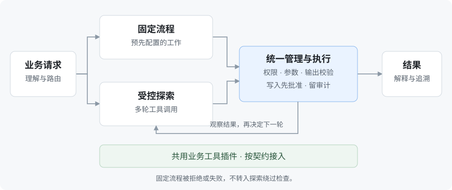
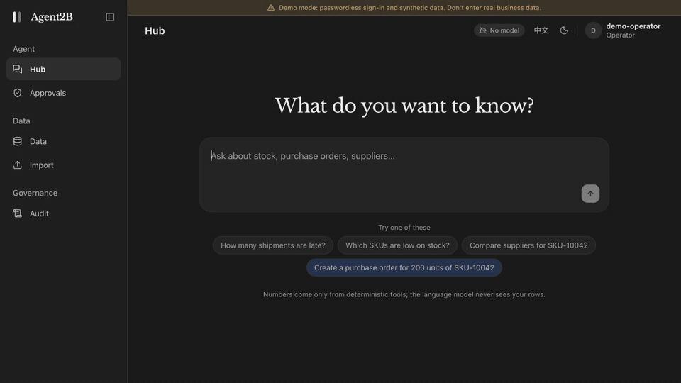
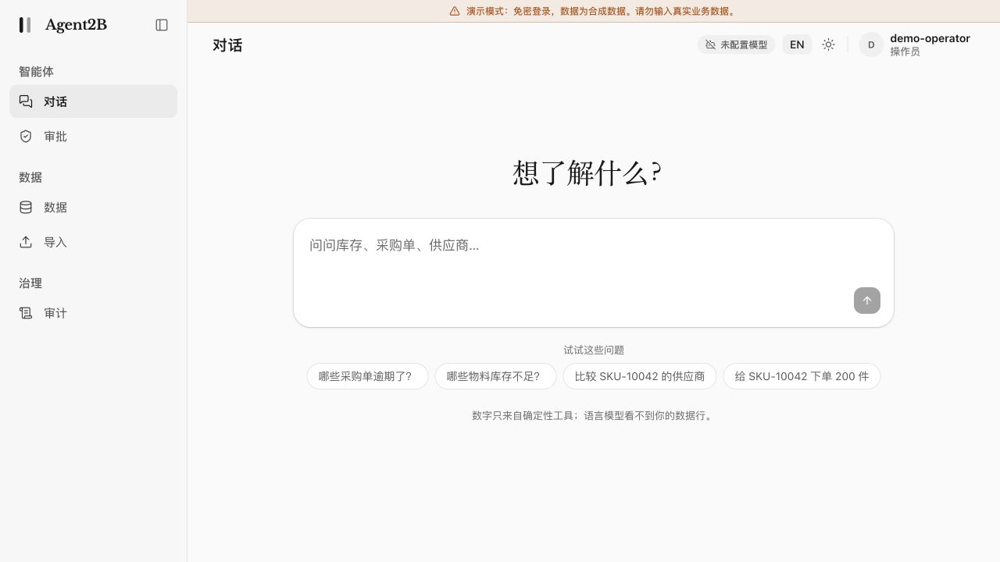

# Agent2B

**以数据安全与结果准确性为核心的插件化企业 agent 架构参考。**

Agent2B 将预先配置的固定流程与多轮工具调用的受控探索，接入同一条执行与管理链路。模型理解请求、编排工具、解释结果；代码负责计算、权限和执行；需要写入的操作由人批准。业务工具以插件接入，供应链控制台展示了这套结构如何运行。

[](https://github.com/wangxuzhou666-arch/Agent2B/actions/workflows/ci.yml)
[](LICENSE)

[English](README.md) | 简体中文

## 适合谁，能帮你做什么

- **企业应用开发者**：为已有业务系统增加自然语言查询和操作入口，复用权限、批准和审计链路。
- **数据与业务平台团队**：用代码计算库存、订单等业务指标，让模型解释结果；关键写入保留人工控制。
- **搭建 agent 工作流的团队**：从可运行的控制台、工具插件和两条执行路径出发，减少从零搭建的工作。

当前是 **v0.1.0rc1 架构参考**。它提供合成数据演示和扩展方式，接入真实业务仍需要你的工具实现、权限配置与部署验证。

## 核心工作流：两种任务，一条管理链路

库存合计、订单筛选和权限判断需要可重复、可核对的结果，因此交给确定性代码；模型负责理解问题、选择工具和组织语言。对“这些延期会造成什么影响，该怎么处理？”这类开放问题，模型可以规划多步调用，但每一步都受同一套执行规则约束。



| 路径 | 发生什么 |
|---|---|
| **固定流程：预先配置的工作** | 提前定义工具、步骤与业务规则 → 请求匹配已有流程 → 代码执行查询与计算 → 返回结果。 |
| **受控探索：多轮工具调用** | 未被固定流程覆盖的问题，经明确交接进入探索 → 选择允许的工具 → 观察结果 → 决定下一次调用或结束。每一轮都经过统一执行管道，不能绕过已被拒绝或失败的固定流程。 |

**统一链路是架构的核心。** 两种任务共用权限检查、参数与输出校验、写入批准和审计；业务工具也共用一套插件契约。

**Harness 是多轮调用的运行约束。** 宿主筛选可用工具、校验参数，限制轮数、调用次数和时间，并记录过程。探索只能提出写入建议；批准凭据绑定用户、操作和参数，模型拿不到凭据，获批后才执行。[架构说明](docs/ARCHITECTURE.md)

## 数据安全与结果准确性

**准确性从执行方式开始。** 查询、筛选和计算由代码完成，模型基于结果组织语言；数字检查会拦截其能识别的、缺少结果依据的数字表述。模型仍可能选错参数或解释失当，因此保留来源、执行过程和写入前确认，方便核对。

**数据安全从减少模型可见信息开始：**

- **先减少外发数据。** 控制台和探索向模型提供汇总、行数、列名及工具说明，不发送明细行。模型仍会看到脱敏后的问题、必要的工具定义和结果文字。
- **外发前脱敏。** 对已标记为受限的文本字段，按库中当前值匹配并替换为 `[REDACTED]`；无法加载这些值时停止模型调用。此规则有长度与匹配限制，不能自动识别所有敏感信息。
- **把数据与指令分开。** 工具结果中的自由文本加上不可信内容边界，降低指令注入风险；权限和批准由宿主代码执行。探索中的外部调用工具还需部署者明确允许，并逐次获得批准。

**边界也要清楚：** 汇总、标识符和工具说明仍可能敏感；文本围栏不能消除注入，运行进程也没有网络隔离。真实部署需审查插件输出、选择可信模型服务并限制网络出口。MCP 主动开启 `--rows` 会扩大模型可见数据。详见[安全边界](SECURITY.md)与 [MCP 文档](docs/MCP.md)。

## 一键试用：先跑通，再接自己的业务

准备好 Git、Docker Compose 和 `make`，启动 Docker 后执行：

```sh
git clone https://github.com/wangxuzhou666-arch/Agent2B.git && cd Agent2B && make up
```

打开 **http://localhost:3000**，选择 **Operator**。首次启动会构建镜像并载入合成数据，**不需要模型 API key**。

1. 问 **“哪些采购单逾期了？”**：查看代码计算的结果、来源和执行过程。
2. 问 **“给 SKU-10042 下单 200 件”**：查看批准卡；只有点击批准才会写入，再到 Audit 查看记录。

[](docs/images/agent2b-hub-demo-en.mp4)

**[观看或下载 44 秒英文演示（MP4）](docs/images/agent2b-hub-demo-en.mp4)。** 在同一个 Hub 对话里完成：查询风险 → 多轮工具调查 → 人工批准 → 创建草稿采购单 → 继续查询状态。实际界面连续录制，保留输入、提交、工具响应与批准过程，仅缩短无操作的停顿。MP4 首帧直接展示中枢，另附轻量步骤提示与低音量的连续背景音乐。使用合成数据与预设 mock 探索脚本。批准后创建的是草稿，不会向供应商正式下单。

<details>
<summary>Agent2B 中文控制台截图</summary>



</details>

默认使用 **mock 模型和模板回答**。下列开放式请求会运行预设的探索脚本，演示多步工具调用和写入批准；其他自由提问不会获得真实模型推理。

```text
Several orders from SUP-001 are slipping, SKU-10053 among them. Work out what that puts at risk and propose what to do.
```

请按原文试用。[案例与验证范围](docs/EVIDENCE.md)区分了工程链路验证和真实模型效果，后者目前尚未验证。

<details>
<summary>停止、检查与接入模型</summary>

- `make down`：停止容器，保留数据卷。
- `make smoke`：检查运行中的示例链路，需要 Python 3。
- 没有 `make`：进入仓库后执行 `docker compose up -d --build --wait`。
- 接入兼容的模型服务：配置 `TWOTRACK_PROVIDER=openai_compat`、`TWOTRACK_LLM_MODEL`、`TWOTRACK_LLM_BASE_URL`，需要认证时通过本地环境或秘密管理器提供 `TWOTRACK_LLM_API_KEY`。容器配置见 [docker-compose.yml](docker-compose.yml)，探索配置见[架构文档](docs/ARCHITECTURE.md#exploration)。凭据不要提交到仓库。

演示模式免密码登录，端口只绑定本机；不要把它直接暴露到公网。接入模型前，先确认允许发送哪些数据。

</details>

## 插件化扩展与社区参与

把自己的业务能力封装成工具插件，声明参数、输出、批准要求，以及是否允许探索调用。注册后，固定流程可以使用它；明确允许且符合用户权限的工具，也可进入多轮探索。核心仍掌管权限，插件不能自行放宽角色的写入权限。

欢迎分享使用场景、复现问题和提交小范围 PR。可以从这些地方参与：

- [接入一个业务工具](docs/ADD_A_TOOL.md)：复用两条路径的权限、批准与审计。
- [增加一种数据类型](docs/ADD_A_CATEGORY.md)：按声明扩展导入和查询。
- [改进示例、文档与回归用例](CONTRIBUTING.md)：让下一位使用者更容易上手。

较大的改动先在 [Issues](https://github.com/wangxuzhou666-arch/Agent2B/issues) 说明场景和预期结果。反馈请使用合成数据，不附业务明细或凭据；安全问题按 [SECURITY.md](SECURITY.md) 私下报告。

[贡献指南](CONTRIBUTING.md) · [路线图](ROADMAP.md) · [设计决策](docs/decisions/README.md)

## 验证与许可

已有自动化检查覆盖后端、前端、浏览器流程、工具边界和 Docker 演示。默认演示证明运行链路，不代表真实模型效果；数字检查也不能保证全部语义正确。[验证证据](docs/EVIDENCE.md) · [已知限制](SECURITY.md#known-limits)

[Apache-2.0](LICENSE) · [第三方署名](NOTICE)
