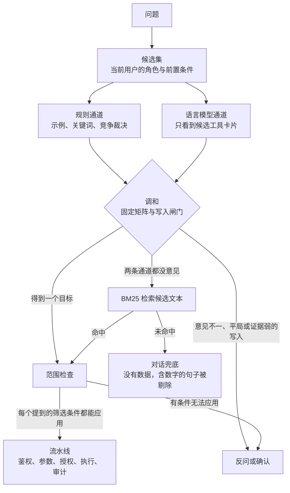
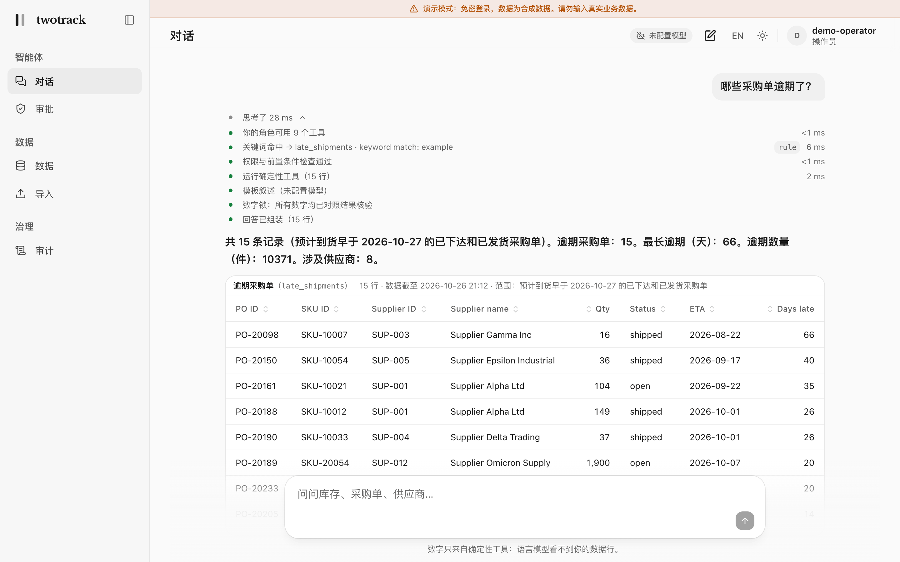
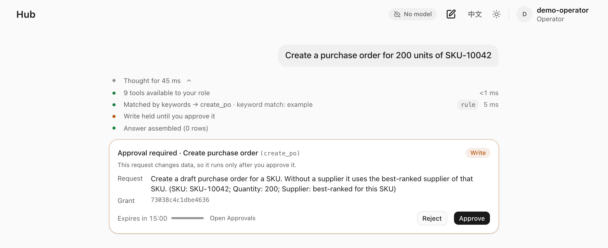
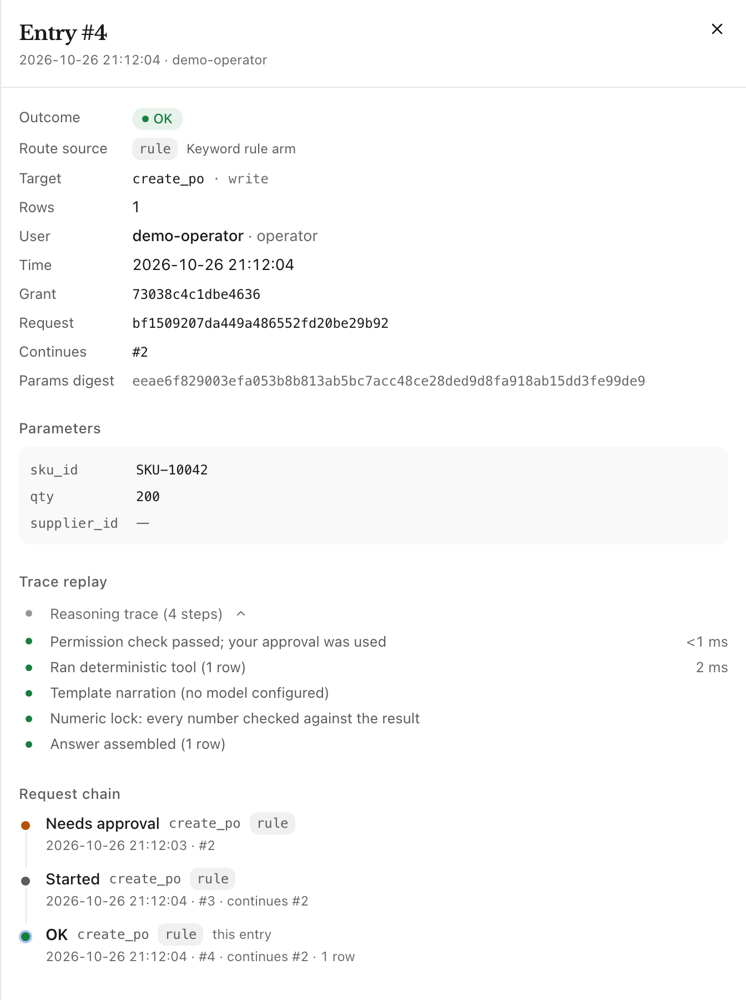
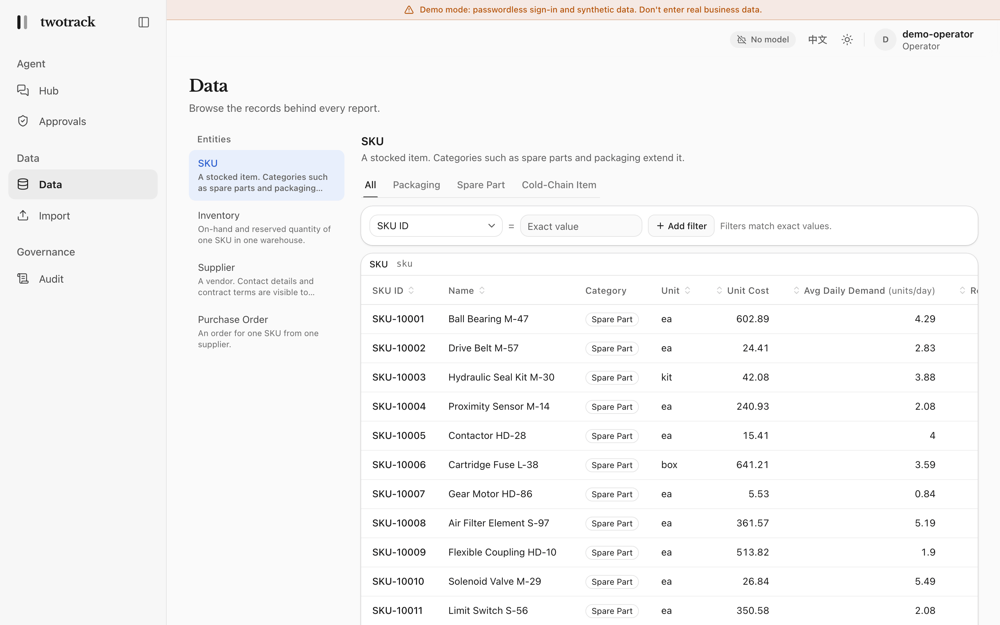
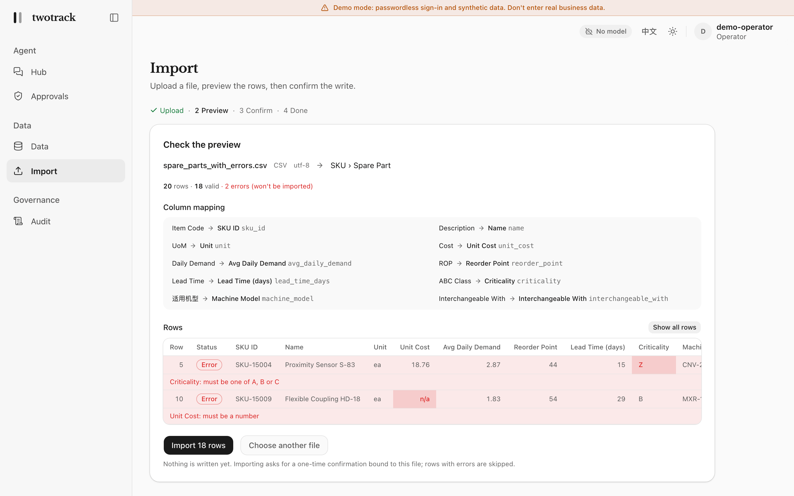

# twotrack

**语言模型只负责路由与叙述，数字全部由代码计算。** twotrack 是一个自包含、可运行的企业任务架构基线，建立在两条轨道上：

1. **固定流程。** LangGraph 把问题路由到已注册的工具或工作流；数字、权限、校验和一切不可逆的副作用都由确定性代码负责。
2. **探索。** 没有任何固定流程覆盖的开放式分析，在 [Pi](https://www.npmjs.com/package/@earendil-works/pi-agent-core)（`@earendil-works/pi-agent-core`，固定为 1.2.0）里运行，Pi 跑在受限的 Node 工作进程中。Pi 只能调用宿主暴露的工具，每次调用都回到同一道闸门：鉴权、前置条件、校验、授权、执行、审计。写入永远只是提案，并停下来等待一次性、与参数绑定的人工审批。

两条轨道共用插件，以及同一套权限与审计契约。演示是一个合成的供应链控制台：数字由工具计算，模型文字里的数字会与工具结果核对，模型看到的是聚合值而不是数据行，也不会凭自己一句话写入数据。

[](https://github.com/wangxuzhou666-arch/twotrack/actions/workflows/ci.yml)
[](LICENSE)
[](pyproject.toml)

[English](README.md) | 简体中文


## 问题与思路

让模型自己算数的智能体，迟早会给出一个错误数字，而错误数字看起来和真实数据没有区别。把整张表交给模型也没用：它会在自己的文字里筛选、加总、估算，每个数字都变成模型的心算。twotrack 这样分工：

- **模型负责路由与叙述。** 它可以决定哪个工具回答这个问题、提出该工具的参数，并用文字描述结果；参数由代码校验。探索时它还会规划调用哪些已暴露的工具，每次调用都要过同一道闸门。
- **确定性工具计算数字。** 工具返回聚合值和数据行。在控制台和两种探索运行时里，模型看到的是聚合值、行数、列名，以及工具写下的 `message` 和 `scope` 文字，看不到数据行。这些文字可能带有工具选择上报的标识符：文档里的探索用例就是通过供应商评分卡的 message 传递了 `SUP-007`。`twotrack mcp --rows` 是需要主动开启的选项，会把最多 50 行数据发给 MCP 客户端的模型（[docs/MCP.md](docs/MCP.md)）。
- **数字锁核对叙述。** 引用了结果无法支撑的数字的句子会被整句删除；一句都不剩时，回答由结果生成的固定模板给出。数字锁读的是数字符号，不是文字：用英文拼写出来的数（如 "three"）不会被识别，裸年份、序数、日期和标识符也不检查（[SECURITY.md](SECURITY.md#what-the-model-sees-and-what-an-injected-instruction-can-do)）。
- **每一次写入都要人工一次性审批**，审批绑定发起人、执行的操作和具体参数。
- **运行、审批和拒绝都有轨迹、有审计。** 流水线的运行、导入和审批决定都会写入审计日志，探索在进入流水线之前拒绝的调用也一样。写入与它的审计记录在同一个事务里提交，「审计」窗口可以逐步回放这个决策。有些事件不留记录，有些记录只是尽力而为；清单见 [SECURITY.md](SECURITY.md#audit-what-fails-closed-what-does-not)。

## 快速开始

### 用 Docker，不需要 API 密钥

```sh
make up        # 构建 API 和控制台，然后打印控制台地址：http://localhost:3000
make smoke     # 检查正在运行的服务：无密钥、无模型（检查内容见下）
make down      # 停止，保留数据卷
```

这会启动**演示模式**：在登录页选一个内置演示用户（管理员、操作员、只读用户），免密登录；首次启动会灌入合成的供应链数据；回答由内置 mock 模型生成，所以每条回答都是模板，页头显示「未配置模型」。冷链示例插件已加载，因此「数据」窗口里有一个核心代码从未声明过的「冷链物料」标签页。两个端口只发布在 127.0.0.1 上，请保持这样：任何能访问演示模式 API 的人都能以管理员身份登录（见 [SECURITY.md](SECURITY.md)）。

没有任何报表覆盖的问题走探索轨道：它在真实的 Pi 工作进程里运行，对着仓库自带的 mock 模型。mock 不做规划，只回答「未配置模型」，只有一个例外：对 [`mock_script.py`](src/twotrack/providers/mock_script.py) 里 `EXPLORATION_CASE` 写定的那一个请求，它按固定脚本执行（三次读取，再给出一个等待审批的采购单提案；原文和完整过程见 [docs/EVIDENCE.md](docs/EVIDENCE.md)）。这个脚本演示的是管道接线，不是模型能力：它说明运行时、它的限制和闸门端到端配合正常，说明不了任何模型的探索能力。

`make smoke` 只需要 python3。它以演示操作员身份登录，问一个固定流程能回答的问题和一个没有固定流程覆盖的问题，并检查：固定流程留下了审计记录、没有经过探索器；第二个问题进入探索分支、在 Pi 中对着 mock 模型运行（轨迹里写 runtime `pi`、model `mock`）、正常结束并给出回答、没有失败的模型调用。只有所有检查都通过，它才以 0 退出。

以操作员身份登录后试试下面几个问题（控制台把第一个和第三个做成了起始问题按钮）。每一个都在这份代码上跑过，英文问法的行为与中文一致。

| 提问（中文 / English） | 你会看到 |
|---|---|
| `哪些采购单逾期了？`<br>`How many shipments are late?` | **直接回答。** 规则通道路由到 `late_shipments`；回答附带推理轨迹、来源行和表格，每个数字都是工具算出的聚合值。 |
| `有多少 A 类物料的逾期采购单？`<br>`How many late purchase orders are for class A SKUs?` | **反问。** 逾期采购单报表不能按重要等级筛选，控制台不会用未筛选的数字充当答案，而是给出「显示全部重要等级」（标明未筛选）和能按该条件筛选的报表（[ADR 0004](docs/decisions/0004-scope-guard.md)）。 |
| `给 SKU-10042 下单 200 件`<br>`Create a purchase order for 200 units of SKU-10042` | **审批卡片。** 请求完整，直接进入有效期 15 分钟的一次性授权。点「批准」之前不会写入任何数据；之后「审计」里 `needs_confirmation`、`started`、`ok` 连成一条请求链（[ADR 0005](docs/decisions/0005-one-time-write-grants.md)）。 |
| `Create a purchase order` | **先确认。** 缺少必填参数，路由先让你确认目标，之后才谈得上审批。 |

想看探索轨道，请以操作员身份登录（只读用户拿不到这个写入工具），然后发送 mock 唯一按脚本行事的那个请求。mock 只对下面这一句英文按脚本执行，请按原句输入，中文说法或换个说法都不会触发脚本：

```text
Several orders from SUP-001 are slipping, SKU-10053 among them. Work out what that puts at risk and propose what to do.
```

没有任何报表覆盖它，所以由 Pi 运行。按 mock 的脚本，它经过闸门做三次读取，再提出一个采购单提案，提案出现在审批卡片里；点「批准」之前不会写入任何数据。脚本匹配的是这几个词：大小写、多余空格和句末句号不影响，只有 `SUP-` 和 `SKU-` 后面的编号可以不同（换成没有逾期订单的编号时，脚本在第一次读取后就结束）；其他任何说法都不在脚本里，若它进入探索，mock 只会回答未配置模型。这演示的是管道接线，不是模型在规划（完整过程和各个用例证明了什么见 [docs/EVIDENCE.md](docs/EVIDENCE.md)）。

不想装 Docker？`uv run twotrack demo` 在单个进程里、用临时数据库跑一套自带的演示；它演示的任何一项保证不成立（编造的数字进入回答就是其中之一），都以退出码 1 结束。其中数字锁那一步（有删节）：

```text
[lock] how many units are on hand in WH-EAST   (the mock is told to invent 31337)
  mock draft   120 rows matched (Warehouse: WH-EAST). Units on hand: 107149. … Next period should come in around 31337.
  after lock   120 rows matched (Warehouse: WH-EAST). Units on hand: 107149. …
  numeric lock removed 1 sentence: "Next period should come in around 31337."
```

### 用本地模型

```sh
make up-ollama   # 同一套服务外加 Ollama；首次运行会下载模型（默认 qwen2.5:0.5b）
```

先说实话：自带的 0.5B 模型只能证明链路是通的，compose 文件为 CPU 上的模型调高了模型超时（`TWOTRACK_LLM_TIMEOUT_SECONDS`、`TWOTRACK_LLM_ROUTE_TIMEOUT_SECONDS`）。模型调用超时后，问题仍会被回答（规则加模板），并且回答会说明模型调用失败（见[模型](#模型)）。想要好用的本地模型，把 `OLLAMA_MODEL` 换成更大的，或者在宿主机上原生运行 Ollama，再让 `TWOTRACK_LLM_BASE_URL` 指过去；两种做法在 [docker-compose.yml](docker-compose.yml) 的头部注释里都有说明。

### 用真实模型

任何 OpenAI 兼容端点都可以。用 Docker 时，把变量写进 `docker-compose.yml` 旁的 `.env` 文件（所有变量名见 [.env.example](.env.example)）；密钥要写进一个 `docker-compose.override.yml`，在 `api` 服务上设置 `TWOTRACK_LLM_API_KEY`，因为 compose 文件本身不传任何密钥。不用 Docker 时，在 `uv run twotrack serve` 之前导出这些变量。

```sh
TWOTRACK_PROVIDER=openai_compat
TWOTRACK_LLM_BASE_URL=https://your-endpoint.example/v1   # 探索在 Pi 中运行时同样需要
TWOTRACK_LLM_MODEL=your-model-name
TWOTRACK_LLM_API_KEY=...                                  # 本地端点可不填
```

使用 Claude 时，走 Anthropic 的 OpenAI 兼容端点。有些模型会拒绝非默认的温度；设置 TWOTRACK_LLM_TEMPERATURE=omit 即可在请求中省略温度。否则 twotrack 自己的调用（路由、叙述、对话，以及内置探索器的智能体步骤）都会发送温度。Pi 工作进程根本不发送温度，所以在 Pi 中探索不需要额外设置。模型提供方配置不全时 API 在启动时就拒绝启动；模型调用失败会在回答里如实说明，绝不隐藏（见[模型](#模型)）。

### 本地开发

```sh
uv sync
TWOTRACK_DEMO_MODE=1 TWOTRACK_CORS_ORIGINS=http://localhost:3000 uv run twotrack serve   # API 在 127.0.0.1:8000
cd web && pnpm install --frozen-lockfile && pnpm dev                                      # 控制台在 localhost:3000
```

需要 Python 3.11 及以上、Node 24 和 pnpm 10。检查命令、端到端测试和修改路由器的规则见 [CONTRIBUTING.md](CONTRIBUTING.md)。所有测试都不需要模型密钥。要在本地用 Pi 运行探索：先安装一次工作进程（`cd harness/pi && npm ci --ignore-scripts`，需要 Node 22.19 及以上），再用 `TWOTRACK_ALLOW_OPEN_TASK=1 TWOTRACK_EXPLORER=pi` 启动 API；详见 [CONTRIBUTING.md](CONTRIBUTING.md)。

账号可用 `twotrack users disable / enable / roles / passwd` 管理；演示模式检查请求的 Host，使用代理域名时设置 `TWOTRACK_ALLOWED_HOSTS`。导入仅接受当前角色可见的字段，更新保留文件未提供的字段，也不能改变既有记录的分类。上传读取同时限制非空数据行、包含空白的总行数和表头宽度；每人最多保留十份待预览或待批准的导入，合并计数。详见 [安全边界](SECURITY.md)。

## 工作原理

`decide_route` 是唯一决定「这个问题运行什么」的地方。之后的一切都走同一条流水线，所以鉴权、参数校验、写入授权和审计不是由各个工具自己选择要不要做。



显式指定目标会跳过两条通道，但不会跳过候选集检查。探索（开启时，`TWOTRACK_ALLOW_OPEN_TASK`）接手两条通道和 BM25 都没能安置的问题，位于对话兜底之前。读路径、写路径和模块地图见 [ARCHITECTURE.md](docs/ARCHITECTURE.md)。

**探索轨道**由智能体循环规划：要么是受限 Node 工作进程中的 Pi（`TWOTRACK_EXPLORER=pi`，Docker 部署固定使用），要么是内置循环（不用 Docker 时的默认值，不需要 Node）。无论哪种：

- **只暴露明确允许的工具。** 工具必须由其插件声明为可探索、用户的角色允许运行它、其前置条件成立，并且部署方的允许清单 `TWOTRACK_EXPLORE_TOOLS` 放行（未设置时，放行所有可探索的工具，外部调用除外），才会提供给模型；把数据发出部署环境的调用只有被点名才会提供，并且每次调用仍然要等待审批。
- **每次调用都回到同一道闸门**：鉴权、前置条件、校验、授权、执行、审计。模型只看到每个结果的叙述视图（聚合值，绝不含数据行），其中的两个自由文本字段 `message` 和 `scope` 放在不可信内容围栏内交给模型（它们可能带有工具选择上报的标识符）。
- **写入只是提案。** 它让运行停在常规的一次性授权处；在发起人批准之前，什么都不会执行。
- **探索是移交，不是第二次机会。** 它只为路由器移交过来的问题启动；指定了显式目标，或已在固定流程中得出结果的请求，会被一道守卫拒绝。
- **拒绝会被记录。** 在进入流水线之前被拒绝的调用（未知或未暴露的工具、无法使用的参数、用尽的预算），两种运行时都会写入轨迹和审计；记录写不进去，运行就停止。
- **运行有预算，两种运行时都一样。** 模型轮数（`TWOTRACK_EXPLORE_MAX_TURNS`，默认 4）、模型要求的工具调用次数（被拒绝的也算，`TWOTRACK_EXPLORE_MAX_CALLS`，默认 6）和一次运行的墙钟时间（秒，`TWOTRACK_EXPLORE_TIMEOUT_SECONDS`，默认 120）。使用 Pi 时，`TWOTRACK_EXPLORE_TOOL_TIMEOUT_SECONDS`（默认 30）限定工作进程等宿主回答一次调用的时间，`TWOTRACK_EXPLORE_STARTUP_TIMEOUT_SECONDS`（默认 20）限定工作进程的启动时间（在运行计时开始之前）。轮数或调用次数用尽会停止运行，回答先说明这个原因；超过墙钟时间或工作进程出错，则以错误结束。不会退回另一种运行时。
- **Pi 工作进程是受限的，不是沙箱。** 它以 `node --permission` 启动，只能读取自己的安装目录，不能写文件、不能起子进程、不能起 worker 线程；工作目录是临时目录，环境变量是白名单，依赖固定为同一个版本并在启动时核对。网络没有被限制。Node 自己把权限模型称为面向可信代码的「安全带」（seat belt），对恶意代码不提供安全保证，所以剩下的威胁是 `harness/pi` 里被攻陷的依赖：它可以借开放的网络把问题、工具结果或模型密钥（如果配置了）发出去。请让 Node 保持在当前的安全版本，并在应用之外加一道出口流量控制（[SECURITY.md](SECURITY.md#exploration-the-boundary)）。工作进程执行轮数和调用次数预算；宿主再执行一遍调用次数预算和墙钟时间。

[SECURITY.md](SECURITY.md#exploration-the-boundary) 写明了边界及其局限；[harness/pi/README.md](harness/pi/README.md) 有工作进程的安装、限制和行协议。

控制台有五个窗口：

- **对话**：提问；每个回答都带实时推理轨迹（含路由来源标记）、来源行、数字锁删句提示、结果表格、澄清选项，写入被拦住时还有审批卡片（页首动图）。<br>
- **审批**：待处理的写入和导入，倒计时以服务器时钟为准。只有发起人能批准；管理员可以拒绝任何人的请求。<br>
- **审计**：路由来源与结果概览、可筛选的日志；每条记录有脱敏后的参数、推理回放和请求链。<br>
- **数据**：由 schema 驱动的实体浏览器，带分类标签页（插件加入的新分类会自己出现）、服务端排序与分页、带类型的筛选，角色无权查看的受限字段不会下发。<br>
- **导入**（操作员、管理员）：上传、预览列映射和逐单元格错误，再通过同一张审批卡片确认。<br>

控制台是双语的（中文和英文；回答用什么语言由提问的语言决定）。英文界面的截图见 [README.md](README.md)。

## 三个性质及其证据

**可追溯。** 每个决策都留下轨迹：候选集、两条通道各自的意见、范围检查、闸门、执行、叙述和数字锁。每个回答的路由来源是 `explicit`、`rule`、`llm`、`llm_confirm`、`semantic`、`agent`、`mcp`、`fallback` 之一。审计日志为它所记录的每个决策保存完整的决策阶梯，可以逐步回放；已批准的写入以 `parent_id` 串成一条请求链。证据：[`tests/server/test_audit_replay.py`](tests/server/test_audit_replay.py)、[`tests/routing/test_reconcile_matrix.py`](tests/routing/test_reconcile_matrix.py)（矩阵的每个格子一个用例）、[ADR 0002](docs/decisions/0002-two-routing-arms-and-a-reconcile-matrix.md)、[ADR 0008](docs/decisions/0008-fail-closed-audit.md)。

**数字准确。** 代码计算：工具返回 `ToolResult`，叙述者只看到聚合值、行数、列名、范围和消息，看不到任何一行。数字锁能读阿拉伯数字、全角数字和中文数字，删除含有结果无法支撑的数字的句子，小整数也不豁免，但用英文拼写的数不会被读到。模型确实会选参数：语言模型通道会提出参数，探索中则由模型给出每一个参数。参数由代码校验，校验拒绝格式错误的值，拒绝不了貌似合理却不对的值，写入的确切参数会显示在审批卡片上。「数字对、问题错」这类错误由范围检查来拦。证据：[`tests/guards/test_numeric_lock.py`](tests/guards/test_numeric_lock.py)、[`tests/providers/test_providers.py`](tests/providers/test_providers.py)、[`tests/graph/test_graph_with_real_guards.py`](tests/graph/test_graph_with_real_guards.py)、[`tests/plugins/test_scope_guard.py`](tests/plugins/test_scope_guard.py)、[ADR 0001](docs/decisions/0001-code-computes-the-model-narrates.md)、[ADR 0004](docs/decisions/0004-scope-guard.md)。

**安全。**
- *一次性授权。* 写入只有在持有随机令牌时才会执行：令牌的 SHA-256 绑定（用户、目标、已校验参数）的 SHA-256，有效 15 分钟，由一条带条件的 `UPDATE` 消耗，所以并发的两次批准不会都成功。重复批准（包括第一次批准还在执行时到达的第二次批准）返回 409，过期返回 410，批准别人的请求返回 403，每次拒绝都有审计记录。证据：[`tests/pipeline/test_pipeline_grants.py`](tests/pipeline/test_pipeline_grants.py)、[`tests/server/test_approval_refusals.py`](tests/server/test_approval_refusals.py)、[ADR 0005](docs/decisions/0005-one-time-write-grants.md)。
- *启动即失败（fail-closed）。* 插件注册表无效、数据库与注册表不一致、签名密钥文件他人可读、`TWOTRACK_*` 配置格式错误、CORS 使用通配符、模型提供方配置不全（它绝不会悄悄退回 mock），或探索运行时无法运行（缺少 Node 或固定版本的 Pi 安装，它绝不会退回另一种运行时），服务器都拒绝启动。例如 `TWOTRACK_PROVIDER=openai_compat uv run twotrack serve` 会打印 `error: cannot start: TWOTRACK_PROVIDER=openai_compat needs TWOTRACK_LLM_MODEL`。证据：[`tests/core/test_registry.py`](tests/core/test_registry.py)、[`tests/store/test_store_sqlite.py`](tests/store/test_store_sqlite.py)、[`tests/guards/test_secret_file.py`](tests/guards/test_secret_file.py)、[`tests/server/test_runtime.py`](tests/server/test_runtime.py)、[`tests/explore/test_selection.py`](tests/explore/test_selection.py)。
- *不可信文本加围栏。* 出站防护在任何模型调用前，把库里受限文本字段的值替换为 `[REDACTED]`；读不到这些值就不发起调用。工具代码从存储记录里派生的文本（结果的 `message` 和 `scope`），只会放在带随机 nonce 的边界内交给做叙述或探索的模型，形似边界的片段会被改写。MCP 导出不对结果加围栏（见 [SECURITY.md](SECURITY.md#known-limits)）。证据：[`tests/guards/test_egress.py`](tests/guards/test_egress.py)、[`tests/providers/test_providers.py`](tests/providers/test_providers.py)。
- *上传守卫。* 任何解析器运行之前先检查：大小、按内容做的文件类型检查（`sniff_file_type`：以 zip 开头的按 xlsx 处理；旧版 xls、已知的二进制文件签名、文件名为 `.xlsx` 但内容不是 zip 的文件，以及开头出现 NUL 字节的文件都会被拒绝；其余文本一律按 CSV 读取）、xlsx 的 zip 炸弹检测；之后读取时，一旦超过行数上限就拒绝整个文件。形状不对的文件会在之后因缺少必填列被拒绝。列只通过声明过的表头映射；有歧义就拒绝整个文件；提交时对同一份字节重新校验。证据：[`tests/importer/test_importer.py`](tests/importer/test_importer.py)、[ADR 0007](docs/decisions/0007-deterministic-import.md)。
- *审计。* `started` 记录写不进去，写入就不执行；`ok` 记录与数据变更在同一个事务里；读取的审计记录写失败，结果就不返回。证据：[`tests/pipeline/test_pipeline_audit_failclosed.py`](tests/pipeline/test_pipeline_audit_failclosed.py)、[ADR 0008](docs/decisions/0008-fail-closed-audit.md)。
- *探索有边界。* 一次运行只会被提供宿主暴露的工具，每次调用都过同一道闸门，写入是一次性授权后面的提案，Pi 工作进程在 Node 权限模型下运行（不能写文件、不能起子进程、不能起 worker 线程），环境变量是白名单，但它的网络没有被限制。证据按层级：边界测试跑内置循环，Pi 运行时则主要对着一个假工作进程（[`test_exposure.py`](tests/explore/test_exposure.py)、[`test_handover.py`](tests/explore/test_handover.py)、[`test_refusals.py`](tests/explore/test_refusals.py)、[`test_fake_worker.py`](tests/explore/test_fake_worker.py)，都在 `tests/explore/` 下；最后一个还检查启动工作进程时用的命令行、工作目录和环境变量；[`test_lockdown.py`](tests/explore/test_lockdown.py) 则检查按同样方式启动的 Node 进程被拒绝读取 harness 目录之外的文件、写文件、起子进程、起 worker 线程和加载原生扩展）；真实工作进程对着 mock 和脚本化模型（[`tests/explore/test_pi_runs.py`](tests/explore/test_pi_runs.py)、`make smoke`）。

[SECURITY.md](SECURITY.md) 是威胁模型，包括已接受的风险（待审批的授权令牌以明文存放在数据库中）和不在范围内的事项：能访问宿主机或数据库的人、插件（受信任的进程内代码）、你所配置的模型端点本身的安全，以及已登录用户发起的拒绝服务。

## 扩展

插件可以新增工具或物料分类，不改核心代码，两条轨道都会用到它：固定流程可以路由到它；如果插件声明自己可探索，探索也可以拿到它。

- [docs/ADD_A_TOOL.md](docs/ADD_A_TOOL.md)：新增一个只读工具，包括参数、处理函数，以及声明谁能运行它、能返回什么、每次运行是否需要人工审批、探索能否提供它。
- [docs/ADD_A_CATEGORY.md](docs/ADD_A_CATEGORY.md)：新增一个物料分类，之后所有现有报表都能用它。

插件是在服务进程内运行的受信任代码，不是沙箱，但安装插件不会带来额外权限：角色与副作用对照表由核心掌管（[SECURITY.md](SECURITY.md#plugin-trust-model)）。新增一个物料分类只需要一个 Python 文件，不改核心代码，也不做迁移（[ADR 0006](docs/decisions/0006-categories-extend-a-root-with-attrs.md)）。下面是 [docs/ADD_A_CATEGORY.md](docs/ADD_A_CATEGORY.md) 里的示例，该文档还带你走完导入数据、提问并路由到它的全过程：

```python
from twotrack.core import EntitySpec, FieldSpec, FieldType, Plugin

HAZARD_CLASSES = ("flammable", "corrosive", "toxic", "oxidizer")

HAZMAT_ITEM = EntitySpec(
    id="hazmat_item",
    label={"en": "Hazmat Item", "zh": "危险品物料"},
    description={"en": "An item that needs hazardous-goods handling.",
                 "zh": "需要按危险品处理的物料。"},
    extends="sku",
    synonyms={"en": ("hazmat", "hazardous goods"), "zh": ("危险品",)},
    attrs=(
        FieldSpec(id="un_number", label={"en": "UN Number", "zh": "UN 编号"}, required=True,
                  description={"en": "Four-digit UN number of the substance.",
                               "zh": "物质的四位 UN 编号。"},
                  aliases=("un no", "UN编号")),
        FieldSpec(id="hazard_class", label={"en": "Hazard Class", "zh": "危险类别"},
                  description={"en": "Main hazard of the item.", "zh": "物料的主要危险性。"},
                  type=FieldType.ENUM, enum_values=HAZARD_CLASSES, aliases=("hazard",)),
        FieldSpec(id="flash_point_c", label={"en": "Flash Point (C)", "zh": "闪点"},
                  description={"en": "Lowest temperature at which vapour can ignite, in "
                                     "degrees Celsius.",
                               "zh": "蒸气可被点燃的最低温度，单位摄氏度。"},
                  type=FieldType.FLOAT, unit="C", aliases=("flash point",)),
    ),
)

PLUGIN = Plugin(name="hazmat", version="0.1.0", entities=(HAZMAT_ITEM,),
                description="Hazmat item category.")
```

用 `TWOTRACK_PLUGIN_PATHS=my_plugins` 启动服务器，这个分类就会出现在「数据」的标签页和「导入」的目标列表里；提到「危险品」的问题，仅凭声明的同义词就会绑定到内置库存工具的 `category` 筛选上。插件按名称排序加载并统一校验。只要有一个插件存在这些问题，服务器就不会启动：导入出错、名称重复、未知的前置条件、`extends` 成环、子类声明了核心字段、两个字段共用一个导入表头、受限字段没有 `visible_roles`、工具没有声明角色、永远匹配不上的范围短语；所有问题会一次性全部报出。刻意不做自动迁移。

## 模型

- **无密钥（默认）。** `TWOTRACK_PROVIDER=mock`。mock 不参与路由，叙述用确定性模板。它在各处都贴着标签：页头显示「未配置模型」，轨迹里写「模板叙述（未配置模型）」，`GET /api/health` 报告 `provider.mock`。不会把功劳记给没有运行过的模型（[ADR 0009](docs/decisions/0009-honest-zero-key-mode.md)）。
- **任意 OpenAI 兼容端点。** `TWOTRACK_PROVIDER=openai_compat`、`TWOTRACK_LLM_MODEL`（必填）、`TWOTRACK_LLM_BASE_URL`（OpenAI、vLLM、Ollama 等）、`TWOTRACK_LLM_API_KEY`（本地端点可不填）。API 不会返回密钥或端点（`GET /api/health` 只报告提供方的名称、模型，以及是否为 mock）。
- **Claude**：通过 Anthropic 的 OpenAI 兼容端点使用时，设置 `TWOTRACK_LLM_BASE_URL=https://api.anthropic.com/v1/`。`TWOTRACK_LLM_TEMPERATURE` 不设置时每类调用用自己的温度（路由 0、叙述 0.2、对话 0.3、内置探索器的智能体步骤 0）；0 到 2 之间的数字则对所有调用生效。有些模型会拒绝非默认的温度；设置 TWOTRACK_LLM_TEMPERATURE=omit 即可在请求中省略温度。Pi 工作进程无论如何都不发送温度。
- **超时。** `TWOTRACK_LLM_TIMEOUT_SECONDS`（回答，默认 30）和 `TWOTRACK_LLM_ROUTE_TIMEOUT_SECONDS`（路由意见，默认 10）。不做重试，所以慢端点只会耗掉一次超时。
- **模型调用失败会被如实报告。** HTTP 错误、超时、无法解析的回复都会让回答降级（路由退回规则加 BM25，文本退回模板），并且回答会说明这一点：返回体带 `model_errors`，记录是哪个调用、错误类名和 HTTP 状态码，绝不包含错误消息或请求内容；轨迹里有记录，控制台也会在回答下方加一行提示，写明哪些调用失败了。配置了模型却失败，不会被当成模型答的，也不会被当成 mock。探索中模型调用失败会让这次运行以错误结束，不会退回另一种运行时。
- **MCP。** `uv run twotrack mcp --user NAME` 通过同一条流水线，把同样的工具提供给 Claude Desktop、Cursor 或任何 stdio 客户端。默认返回聚合值和摘要，不含数据行，其 `message` 和 `scope` 是纯文本，没有按不可信内容加围栏；`--rows`（`TWOTRACK_MCP_ROWS`）可主动开启，把最多 50 行数据发给客户端的模型，受限字段会被移除。写入工具返回 `needs_confirmation`，由用户在控制台批准。详见 [docs/MCP.md](docs/MCP.md)。

## 基准测试

错数基准测量的是：回答里出现错误数字的频率。对比对象是标准的工具调用智能体、事后加了数字锁的同一个智能体，以及 twotrack，三者使用相同的模型、工具和数据。标准答案由数据库计算得出，不是手写的。**v0.1 不发布任何结果**：没有记录过真实模型的运行，在 mock 提供方上的运行只用来检查测试框架本身。

测试集是留出集。路由器的改动依据另一份开发集（[`tests/routing/test_dev_phrasings.py`](tests/routing/test_dev_phrasings.py)）来做，开发集在每次改动之前写好；仍然答错的条目保留为严格的预期失败，修好了不可能不被发现。基准题目只在能力发生变化时才改，每次都有变更记录（[docs/LESSONS.md 第 3 节](docs/LESSONS.md)）。它测量的是固定流程轨道；用真实模型测探索是另一次单独的运行：命令见 [docs/EVIDENCE.md](docs/EVIDENCE.md)，目前还没有这样的运行记录。

```sh
uv run python -m bench.run --system all --provider mock   # 干跑：检查框架，不是结果
```

真实运行需要你自己的端点和密钥、预算估算以及 `--confirm`；定义、评分规则和有效性威胁见 [bench/README.md](bench/README.md)。

## 设计决策

| ADR | 决策 |
|---|---|
| [0001](docs/decisions/0001-code-computes-the-model-narrates.md) | 代码计算，模型叙述：在控制台和探索中，模型只看聚合值不看数据行，数字锁删除结果无法支撑的句子。 |
| [0002](docs/decisions/0002-two-routing-arms-and-a-reconcile-matrix.md) | 两条路由通道加一张调和矩阵：规则和模型各给独立意见，一致就运行，不一致就问用户。 |
| [0003](docs/decisions/0003-keyword-contests-settled-by-evidence.md) | 关键词竞争由证据裁决，而不是比关键词长短：以 BM25 对问题其余部分评分，领先 2 倍才算赢，否则反问。 |
| [0004](docs/decisions/0004-scope-guard.md) | 范围检查：问题里提到了所选工具无法应用的筛选条件时反问，并把未筛选的运行作为带标签的选项。 |
| [0005](docs/decisions/0005-one-time-write-grants.md) | 每次写入都要一次性授权：授权绑定用户、目标和参数；请求完整时直接进入授权。 |
| [0006](docs/decisions/0006-categories-extend-a-root-with-attrs.md) | 分类用 attrs JSON 扩展根实体：新增分类就是一个插件文件，不改核心、不加列，所有报表都能用。 |
| [0007](docs/decisions/0007-deterministic-import.md) | 确定性导入：列只通过声明过的表头映射；有歧义就拒绝；提交时对同一份字节重新校验。 |
| [0008](docs/decisions/0008-fail-closed-audit.md) | 失败即关闭的审计：写入与审计记录一起提交，记录写不进去操作就停止，最后一条记录可回放整个决策。 |
| [0009](docs/decisions/0009-honest-zero-key-mode.md) | 诚实的无密钥模式：没有密钥时 mock 在模型该决策的地方弃权，并在所有位置标明自己是模板。 |
| [0010](docs/decisions/0010-exploration-runs-in-pi-behind-the-same-gate.md) | 探索在 Pi 中运行，过同一道闸门：没有固定流程覆盖的开放式分析在受限的 Pi 工作进程中运行；它只看到被暴露的工具，每次调用都经过流水线，写入只是提案。 |

## 文档

- [docs/ARCHITECTURE.md](docs/ARCHITECTURE.md)：各部分、决策阶梯、读写路径、模块地图。
- [docs/decisions/](docs/decisions/README.md)：决策记录，含备选方案、代价和证据。
- [docs/LESSONS.md](docs/LESSONS.md)：构建过程中出过的问题，以及防止它再出现的守卫。
- [SECURITY.md](SECURITY.md)：漏洞上报、威胁模型、探索边界、插件信任、已接受的风险、已知局限。
- [docs/ADD_A_TOOL.md](docs/ADD_A_TOOL.md)、[docs/ADD_A_CATEGORY.md](docs/ADD_A_CATEGORY.md)：手把手添加工具插件和分类插件。
- [docs/MCP.md](docs/MCP.md)：MCP 导出。
- [docs/EVIDENCE.md](docs/EVIDENCE.md)：两个参考用例和滥用场景、三档证据，以及运行它们的命令。
- [docs/DESIGN.md](docs/DESIGN.md)：控制台的设计系统（设计令牌、组件、布局）。
- [harness/pi/README.md](harness/pi/README.md)：Pi 工作进程（安装、限制、行协议、预算）。
- [bench/README.md](bench/README.md)：错数基准测试。
- [ROADMAP.md](ROADMAP.md)：已知局限和尚未完成的工作。[CONTRIBUTING.md](CONTRIBUTING.md)：环境、检查、提交规范。

以上文档目前均为英文。

## 状态

twotrack v0.1 是这套架构在合成供应链（SKU、库存、供应商、采购单；六个读取工具、一个写入工具、一个工作流）上的参考实现，目的是展示设计及其取舍。整套测试和控制台的端到端测试都使用 mock 提供方或脚本化模型，所以验证这里的一切都不需要模型密钥。证据分三档，本仓库把它们分开（命令和每个用例证明了什么见 [docs/EVIDENCE.md](docs/EVIDENCE.md)）：内置循环配 mock 模型；真实的 Pi 配 mock 模型，其中一个用例是脚本化的（测试、`make smoke` 和 `scripts/evidence.py`）；真实的 Pi 配真实模型，这一档还没有跑过、没有记录（EVIDENCE.md 给出了运行它的命令）。这里不声称第三档的任何结果。

它是一个用来阅读、运行和扩展的基线，不是可直接部署的产品。角色固定为管理员、操作员、只读用户三种；没有多租户、没有按用户的权限矩阵、没有按用户的限流（只对失败的登录做节流）、没有 OpenTelemetry。单个 SQLite 连接意味着同一时刻只有一个写入者。审计日志不防篡改，也不是对一切的记录：登录与登出、经「数据」窗口的读取、用命令行对用户做的修改，以及因过期而被拒绝的导入提交，都不留记录（其余见 [SECURITY.md](SECURITY.md#audit-what-fails-closed-what-does-not)）。插件是在服务进程内运行的受信任代码。探索工作进程的网络没有被限制。compose 给 API 和控制台设置了内存上限和进程数上限（`mem_limit`、`pids_limit`）；不用它部署的话需要自己设置。控制台的内容安全策略仍然允许内联脚本和样式。演示模式只用于本地评估。已知局限和尚未完成的工作见 [ROADMAP](ROADMAP.md)。

## 许可证

Apache-2.0，见 [LICENSE](LICENSE)。[NOTICE](NOTICE) 载有随附字体 Libre Baskerville（SIL Open Font License 1.1）和 `web/src/components/ui/` 中 shadcn/ui 组件（MIT 许可证）的署名声明。
