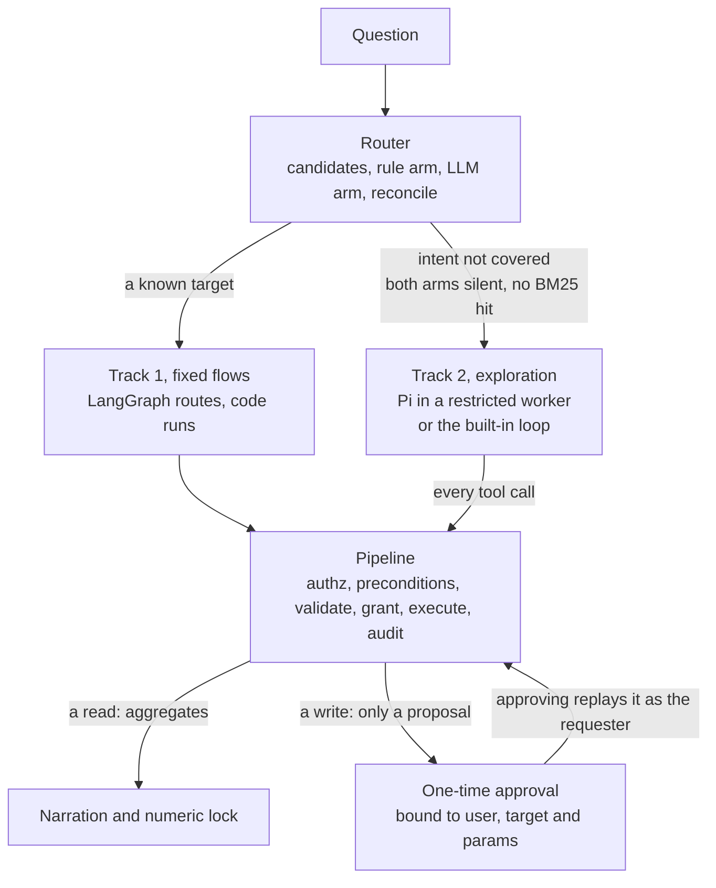
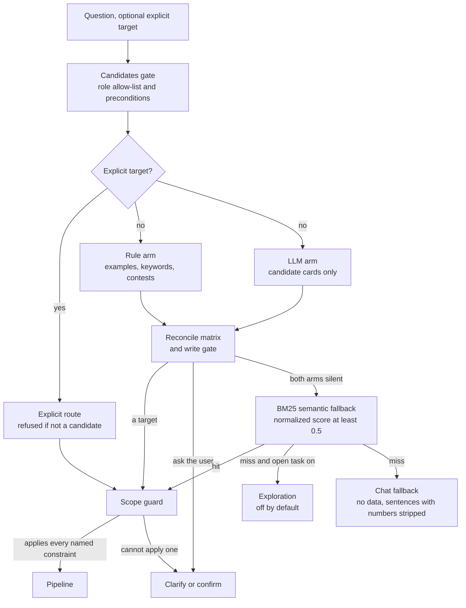
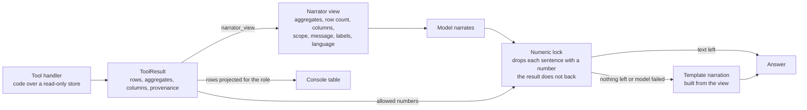
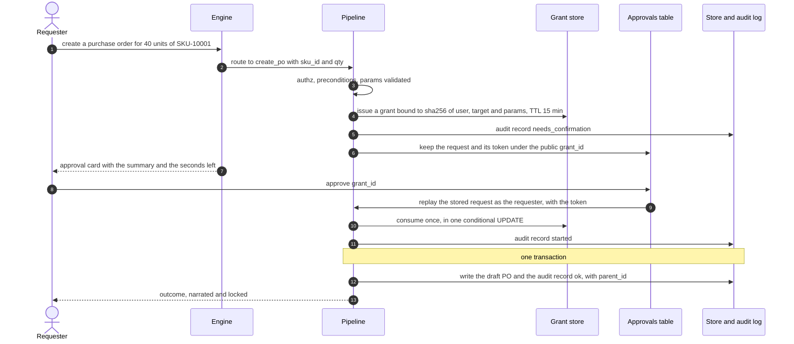

# Architecture

twotrack is a runnable architecture baseline for enterprise tasks, shown as a supply-chain agent
console: people ask questions about inventory, purchase orders and suppliers in English or
Chinese, and the console answers from deterministic tools, holds every write for a one-time
approval, and traces its decisions and audits what it runs (the [Audit](#audit) section says what
the log leaves out). It runs on two tracks, and its thesis holds on both:

> **LLMs route and narrate; code computes.**

A language model may pick which tool answers a question and propose its parameters, may plan a
few tool calls for a request no flow covers, and may describe a result in words. Tools compute
the figures they return and code validates every parameter a model proposes; the numeric lock
removes a sentence of model text whose numerals the result does not back (a number spelled out
in words is the known gap, see [The read path](#the-read-path)). In the console and in both
exploration runtimes a model is shown the schema, aggregates, column names and fenced text, never
rows (`twotrack mcp --rows` is the one opt-in, [MCP.md](MCP.md)), and no write runs on a model's
say-so. This page shows how the
parts fit. Why each part is shaped the way it is, and what
it costs, is in the [decision records](decisions/README.md); what went wrong while building it
is in [LESSONS.md](LESSONS.md); what the two tracks do on your machine, and what each case
proves and does not, is in [EVIDENCE.md](EVIDENCE.md).

## The two tracks

- **Fixed flows.** LangGraph routes each question. Deterministic code owns numbers, permissions,
  validation and irreversible effects. A fixed workflow runs through a deterministic sequential
  executor (`core/workflow.py`). Every known step and every write belongs here.
- **Exploration.** Open-ended analysis that no fixed flow covers. A model plans which of the
  exposed tools to call; it runs in Pi, the `@earendil-works/pi-agent-core` harness, inside a
  restricted Node worker, or in the built-in loop. It can call only the tools the host exposes,
  and every call goes back through the same pipeline. A business write is only a proposal that
  pauses for a one-time, parameter-bound human approval. See [Exploration](#exploration).
- **Shared.** Both tracks use the same plugin registration, the same permission contract (roles,
  effects, approvals) and the same audit contract, so a plugin written once serves both. Why the
  boundary sits where it does: [ADR 0010](decisions/0010-exploration-runs-in-pi-behind-the-same-gate.md).

## Overview

| Part | Where | Job |
|---|---|---|
| Contract | `src/twotrack/core/contract.py` | The types every plugin, router and pipeline stage agree on: `Tool`, `Workflow`, `EntitySpec`, `ToolResult`, `RouteDecision`, `TraceStep`. |
| Registry | `src/twotrack/core/registry.py` | Loads plugins, validates them all at once, refuses to start on any problem, and answers "which targets may this user reach right now". |
| Router | `src/twotrack/core/routing/` | The decision ladder: candidates, rule arm and LLM arm, reconcile, fallbacks, scope guard. Emits one `RouteDecision`. |
| Pipeline | `src/twotrack/core/pipeline.py` | The only way a tool or workflow runs: authz, preconditions, param validation, one-time grants, execution, audit. |
| Engine | `src/twotrack/core/graph/builder.py` | A LangGraph graph, run once per query: `ingress → router → {clarify, execute, open_task, chat} → narrate → respond → record`; a clarification, a write held for approval, an `execute` with no result and an ingress error skip `narrate`. |
| Guards | `src/twotrack/core/guards/` | Numeric lock on narration, egress scrubbing of provider payloads, upload checks on imports. |
| Store and audit | `src/twotrack/core/store/`, `core/audit.py`, `core/database.py` | SQLite: one table per root entity, an audit log and a grant table on one shared connection. |
| Providers | `src/twotrack/providers/` | The only door to a model for routing, narration, chat and the built-in explorer: `route`, `narrate`, `chat`, `agent_step`. A zero-key mock or any chat-completions endpoint (`openai_compat`). |
| Explorer | `src/twotrack/core/explore/`, `harness/pi/` | The second track: the `builtin` loop or Pi in a Node worker, behind one call gate ([Exploration](#exploration)). |
| Server | `src/twotrack/server/` | FastAPI: query over server-sent events, approvals, audit, entities, import, auth. |
| Console | `web/src/` | Next.js client with five windows: Hub, Approvals, Data, Import, Audit. |
| MCP | `src/twotrack/mcp/server.py` | The same tools over the Model Context Protocol, through the same pipeline ([MCP.md](MCP.md)). |

### What a model can and cannot see

In the console, in the chat fallback and in both exploration runtimes:

| A model sees | A model never sees |
|---|---|
| The question, after the egress guard replaced restricted text values with `[REDACTED]` | A single row of any result |
| Cards for the candidate targets only: name, kind, description, route hint, up to three examples, params schema (`core/routing/llm_arm.py`) | Targets outside the candidate set: other roles' tools, tools whose preconditions fail |
| A result's narrator view: aggregates, row count, column names, scope, message, a label per aggregate, the reply language (`ToolResult.narrator_view`, `narration.result_view`) | Grant tokens, the audit log, password hashes, the database |
| In exploration (off by default, either runtime): the fenced narrator view of each call it made, and the tools exposed to the run | The output of a tool it did not call, and any tool that is not exposed |
| In the chat fallback: the descriptions of the candidate targets, and no data | |

The `message` and `scope` of a narrator view are text a tool writes. They are fenced as untrusted
data, and they can carry identifiers the tool chooses to report: in the documented exploration
case the supplier scorecard's message names `SUP-007`, and the proposal uses it
([EVIDENCE.md](EVIDENCE.md)).

The one exception to the right-hand column is opt-in: `twotrack mcp --rows`
(`TWOTRACK_MCP_ROWS`) sends up to `--max-rows` (default 50) projected rows to an MCP client's
model, with restricted fields removed for every role ([MCP.md](MCP.md)).

## The decision ladder

`decide_route` (`src/twotrack/core/routing/router.py`) is the single place that decides what a
question runs.

- **Candidates gate** (`Registry.candidates`): every later step sees only the targets this
  user's roles allow and whose preconditions pass. A precondition that raises counts as failed.
  An explicit target outside the set is refused with the same message whether it is unknown or
  forbidden, so the message never reveals what other roles can run; one the user's roles allow
  but whose precondition fails is refused with what is missing.
- **Rule arm** (`rule_arm.py`): a normalized match against a target's examples is strong; two
  of its keywords are strong; one keyword is weak. Hits of different targets on different words
  are a contest settled by BM25 evidence with a 2x margin
  ([ADR 0003](decisions/0003-keyword-contests-settled-by-evidence.md)). One phrase of a write
  plus every param it requires is strong, also after a contest if the winner cleared the margin
  and the losers matched only names of its own params. Two exceptions cap a hit at weak: a
  request that reads as a question, negates the write's phrase or excludes a value (a write or
  external target is then confirmed before anything is held for approval), and a contest the
  winner took on any other word ([ADR 0005](decisions/0005-one-time-write-grants.md)).
- **LLM arm** (`llm_arm.py`): the provider names one candidate with a confidence, or abstains. A
  name outside the candidate set, a confidence below 0.3 and a provider failure all count as no
  opinion. The two arms do not see each other's opinion; the router calls them one after the
  other.
- **Reconcile** (`reconcile.py`): a fixed matrix of rule strength against model strength
  ([ADR 0002](decisions/0002-two-routing-arms-and-a-reconcile-matrix.md)). Disagreements become
  a question to the user, except that a strong rule hit outweighs a weak model opinion. The
  write gate turns a write or external target reached without strong evidence into a one-option
  confirmation.
- **Fallbacks**: when both arms are silent, BM25 over each candidate's declared text
  (`semantic.py`); a semantic hit on a write is gated too. Then exploration if
  `TWOTRACK_ALLOW_OPEN_TASK` is set (the explorer's budgets and tools are in
  [Exploration](#exploration); every call goes through the pipeline), else chat.
- **Scope guard** (`scope_guard.py`): runs last, on whatever tool or workflow the ladder chose.
  It fills filter params from the question and turns a target that cannot apply a constraint the
  question names into a clarification with an explicitly unfiltered option
  ([ADR 0004](decisions/0004-scope-guard.md)).

Every decision emits an `understand` trace step with both arms' opinions, the contest scores and
the semantic score; the audit log keeps it ([ADR 0008](decisions/0008-fail-closed-audit.md)).
The route source on every answer is one of `explicit`, `rule`, `llm`, `llm_confirm`,
`semantic`, `agent`, `mcp` or `fallback`.

## The read path

A read or external tool receives a `ReadOnlyStore`, and so does every precondition check
(`core/pipeline.py`, `core/store/base.py`). Its write methods raise, `transaction()` is
unavailable, and `query()` runs a single `SELECT` under SQLite's authorizer, which refuses
writes, pragmas and `ATTACH` and reads of any table that is not an entity table
(`core/store/sqlite.py`). That bounds the handle the tool is given, not the tool: a plugin is
trusted in-process code, so a handler can still reach the database file, the environment and the
network ([the plugin model](#the-plugin-model)).
`ToolResult.aggregates` accepts finite numbers only. The numeric lock
(`core/guards/numeric_lock.py`) reads Arabic and full-width digits, Chinese numerals written with a unit, scale words and percentages, and allows a written number when it equals an aggregate, the row count or the
number of rows at the precision it was written. A sentence with any other number is removed whole; a bare year, an ordinal, a date or time, a list marker and a digit glued to a letter (`Q3`, `SKU-123`) are not checked, and a number spelled out in English ("three") is not read. If nothing survives, or the model call fails, the answer is the deterministic template,
whose numbers are copied from the view. The chat fallback is locked against an empty set, so any
sentence of a chat answer that cites a number as a numeral is removed. The rows go to the console's table,
projected for the user's role (`server/projection.py`), and not to a model (`twotrack mcp --rows`
is the one opt-in).
See [ADR 0001](decisions/0001-code-computes-the-model-narrates.md).

## The write path

The token never reaches the browser; the console works with the public `grant_id` (16 hex
characters of the token's SHA-256). The digest covers the validated, canonical params, so `"5"`
and `5` confirm the same request and any other change does not. Only the requester can approve;
an admin can reject anyone's request but approve only their own. The approval replays the request through
the same pipeline as the same user, so a role or precondition that stopped holding in the
meantime stops it. Approving again after it ran, or while the first approval is still running, answers 409, approving after the 15 minutes
answers 410, and each 403, 409 and 410 the approvals endpoints answer is an audit record under the
grant id. Imports follow the same path with a grant bound to the preview's digest. The exception is
the import commit endpoint, which answers an expired preview with a 404 (or, if it expires during
the call, a 410) and writes no record ([ADR 0008](decisions/0008-fail-closed-audit.md)).
See [ADR 0005](decisions/0005-one-time-write-grants.md) and
[ADR 0008](decisions/0008-fail-closed-audit.md).

## Workflows

A `Workflow` is an ordered list of steps (`core/contract.py`). A step is `deterministic` (plain
code) or `llm`, and the registry rejects any workflow that breaks these rules:

- at least one step is deterministic;
- an `llm` step may only be the first step (turn the request into structured input) or the last
  (narrate the result); every middle step is deterministic;
- a first `llm` step followed by more steps must declare an `output_model`, so its output is
  schema-gated before code consumes it. A reply that does not validate becomes a user-facing
  request for the missing details, not an exception (`core/workflow.py`).

The last `llm` step narrates like any tool result: it sees the narrator view, and its text passes
the numeric lock with the template as fallback. The runner is a plain loop rather than a
LangGraph subgraph, because a workflow is a straight line with schema gates and no branching.
The built-in `reorder_plan` is three deterministic steps (find low stock, compute quantities,
group by criticality and pick suppliers), each handing a Pydantic model to the next, then one
narration step (`plugins/supply_chain/workflow.py`).

## The plugin model

A plugin is a module that exports `PLUGIN = Plugin(name, version, entities, tools, workflows, preconditions)`, with an optional `description`. The registry loads the built-in plugins under `src/twotrack/plugins/` and every
`*.py` file or package in the directories listed in `TWOTRACK_PLUGIN_PATHS` (a package needs an `__init__.py`; names starting with `_` or `.` are skipped), in sorted order,
so every prompt and index built from the registry is the same on every machine.

- **Entities.** An `EntitySpec` declares typed core `fields` and category `attrs`, each a
  `FieldSpec` with labels per language, import aliases, an enum domain, a unit and a
  sensitivity. A restricted field must name the roles that may see it.
- **Categories.** An entity that `extends` a root inherits its core fields and may add only
  `attrs`. Its rows live in the root's table with the attrs in a JSON column, so a new category
  never adds a column. `spare_part` and `packaging` extend `sku` this way, and so does the
  drop-in `examples/plugins/cold_chain.py`, loaded with
  `TWOTRACK_PLUGIN_PATHS=examples/plugins` and no core change
  ([ADR 0006](decisions/0006-categories-extend-a-root-with-attrs.md)).
- **Tools.** A `Tool` declares `roles`, `effect` (`read`,
  `write` or `external`, so a forgotten write cannot become a read), `approval` (`required` or
  `none`), `outputs` (the aggregate keys and columns a result may carry) and `explorable`
  (whether exploration may offer it to a model), none with a default, plus a Pydantic params model, keywords and
  examples for routing, a deterministic `param_extractor`, labels for its aggregates and the
  constraints its params apply (`json_schema_extra={"binds": ...}`). The core owns the policy
  that ties them together (`core/contract.py`): a role table (`ROLE_EFFECTS`: viewer may run
  reads; operator and admin reads, writes and external calls) that a target can narrow and never
  widen, so installing a plugin grants no one a permission; a write must require approval and a
  read must not; an external target chooses, and an explorable one must require it. The registry
  refuses to start on a violation, and the pipeline enforces the same declarations on every call
  (role check, grant by `approval`, each result compared with `outputs`).
- **Fail closed.** Every problem of every plugin (an import error, a duplicate name, an unknown
  precondition, an `extends` cycle, a child that declares core fields, colliding import headers,
  a malformed binding, a scope phrase that can never match) is collected into one
  `RegistryError`, and the server does not start.

To add a category step by step, see [ADD_A_CATEGORY.md](ADD_A_CATEGORY.md). A plugin is trusted
code that runs in-process, not a sandbox ([ADR 0006](decisions/0006-categories-extend-a-root-with-attrs.md));
what it declares is checked, what its handlers do is not.

## Exploration

Exploration is the `open_task` route, the one place a model plans its own tool calls. The router
hands a request over only when no fixed flow covers it: both arms silent and no BM25 hit, with
`TWOTRACK_ALLOW_OPEN_TASK` set and at least one candidate for the asker. The router then emits a
`handover` trace step with reason `intent_not_covered` and its evidence, and the explore node
refuses to start (stop reason `handover_refused`) for a request that names an explicit target,
already reached a terminal outcome or was never handed over, so a denial, a validation failure,
a spent budget or an error never becomes a second try by a model.

**Runtimes and settings.** `TWOTRACK_EXPLORER` picks the runtime; nothing falls back from one to
the other. All names are read in `src/twotrack/settings.py` and described in `.env.example`.

| Setting | Default | Meaning |
|---|---|---|
| `TWOTRACK_ALLOW_OPEN_TASK` | off | Turns the route on. |
| `TWOTRACK_EXPLORER` | `builtin` | `builtin`: the loop in `core/agent_loop.py` over the request's provider, no Node. `pi`: Pi in a Node worker (`core/explore/pi.py`); the server refuses to start without Node 22.19 or newer, the worker, or the pinned packages. |
| `TWOTRACK_EXPLORE_MAX_TURNS` | 4 | Model turns. |
| `TWOTRACK_EXPLORE_MAX_CALLS` | 6 | Tool calls the model asks for, refused ones included. |
| `TWOTRACK_EXPLORE_TIMEOUT_SECONDS` | 120 | Wall clock of one run. For `pi` it starts when the worker says hello; start-up has its own timeout. The built-in loop checks it between steps and does not interrupt a model or tool call in flight. |
| `TWOTRACK_EXPLORE_TOOL_TIMEOUT_SECONDS` | 30 | `pi` only: how long the worker waits for the host to answer one call. |
| `TWOTRACK_EXPLORE_STARTUP_TIMEOUT_SECONDS` | 20 | `pi` only: how long the worker may take to start, until it says hello; a worker not up in time ends the run as `worker_unavailable`. |
| `TWOTRACK_EXPLORE_TOOLS` | unset | Allowlist of tool or workflow names. Unset: every explorable target except an `external` one. An unknown or non-explorable name stops the start. |
| `TWOTRACK_PI_HARNESS_DIR` | `harness/pi` of the checkout | Where the worker and its pinned install live. |

**What a run is offered** (`core/explore/exposure.py`). `registry.candidates(ctx)` (the asker's
roles, preconditions met), filtered to targets that declare `explorable=True`, intersected with
`TWOTRACK_EXPLORE_TOOLS` when set; the list never overrides `explorable=False`. An `external`
target is exposed only when that list names it, and each of its calls still waits for approval
(the registry refuses an explorable external target that does not require it). The schemas a
model is shown keep standard JSON Schema keywords only (`core/model_schema.py`). The run's first
`execute` step (`loop: start`) lists the exposed names.

**One gate for every call** (`core/explore/calls.py`). A call goes through the request's pipeline
with route source `agent`: lookup, authorization, preconditions, validation, grant, execution,
audit. The model sees the fenced narrator view of a result, or `status: <problem inside a fence>`
when the pipeline refuses or fails the call (a refusal made before the pipeline is the platform's
own wording about the model's own call and is sent as it is), never a row. A
write gets its grant, the run stops as `needs_confirmation`, and nothing executes until the
requester approves. A call refused before the pipeline (an unknown or unexposed tool, unusable
arguments (not a JSON object, or refused by Pi's own schema check), a spent budget) is traced as
a `gate` step with `blocked_by` naming the runtime, audited in both runtimes, and the run goes on
only within its budget.

**The worker.** One process per run (`harness/pi/worker.mjs`), started as
`node --permission --allow-fs-read=<harness dir>`: file-system reads limited to the harness
directory, no file writes, no child processes and no worker threads; the network is not
restricted. Its working directory and `HOME` are a fresh empty temporary directory, its
environment is an allowlist (`HOME`, `LANG`, and `TWOTRACK_LLM_API_KEY` when a model needs one),
and when the run ends the host closes its stdin and kills its process group if it has not exited
after a short grace (at once after a protocol violation). The three Pi packages are pinned to one exact version in
`harness/pi/package.json`; the worker reports them in `hello`, and the host stops the server at
start-up, and a run, if they differ. With `TWOTRACK_PROVIDER=openai_compat` the worker talks to
the `TWOTRACK_LLM_*` endpoint itself (each request bounded by `TWOTRACK_LLM_TIMEOUT_SECONDS` or the run's
clock, whichever is shorter; no temperature sent); otherwise it talks to a per-run mock endpoint on 127.0.0.1.

**What the restrictions are worth.** They are a safeguard, not a sandbox. Node documents its
permission model as a "seat belt" for trusted code that gives no security guarantee in the
presence of malicious code, and its security releases have fixed bypasses of it (CVE-2025-55130,
a relative-symlink bypass of the file-system permissions, is one). The residual threat is a
compromised dependency among the packages installed in `harness/pi`: it would run in the worker
with the worker's environment and an unrestricted network, and could send out what the worker
holds, which is the question, the tool results (narrator views, never rows) and the model key
when one is set. Against that stand the exact pins, the lockfile, `npm ci --ignore-scripts`, a
current Node security release (the image pins one) and an egress control outside the application.
The tests check the command line, the working directory and the environment the host launches the
worker with (`tests/explore/test_fake_worker.py`, `tests/explore/test_selection.py`), and what a
Node process started with those flags and that environment can and cannot do
(`tests/explore/test_lockdown.py`: reads outside the harness directory, writes, child processes
and worker threads are refused with `ERR_ACCESS_DENIED`, native addons with
`ERR_DLOPEN_DISABLED`, and the environment holds exactly the allowlisted names). On Node 22
and 24 the permission model does not cover the network; Node 25 and later extend it to the
network, and the host passes no flag to allow that (the image and CI use Node 24).

**Worker protocol** (`core/explore/protocol.py`, contract in `harness/pi/README.md`): UTF-8 JSON,
one object per line, at most 1 MiB, stdout for protocol only, unknown fields refused. Worker to
host: `hello` (protocol, package versions, Node), `tool_call` (id, name, args), `event`
(`assistant`; `tool_blocked` with reason `unknown_tool`, `invalid_args`, `truncated`, `max_turns`,
`max_tool_calls` or `aborted`; `tool_timeout`) and `final` (text, stop reason, error, usage,
counts). Host to worker: `start` (task, system prompt, tools, model, budget), `tool_result`
(`ok`, content or code and error, `terminate`) and `abort`. A line that breaks the protocol ends
the run as a failure.

**Trace facts and stop reasons.** A turn that asks for tools is an `execute` step
(`loop: turn`, the tool names requested). The step that ends the run carries `runtime`
(`builtin` or `pi`), `runtime_version`, `model` (`mock` for the zero-key mock), `turns`,
`stop_reason` and each call's tool and outcome (a name the model made up is traced as
`invalid`). The stop reasons:

| Ends as | `stop_reason` |
|---|---|
| answer | `answered` |
| waits for approval | `needs_confirmation` |
| budget (deterministic text, explicit reason) | `max_turns`, `max_tool_calls` |
| error | `timeout` (the wall clock), `model_error`, `audit_failed`, and for `pi` `worker_crashed`, `protocol_error`, `worker_unavailable`, `runtime_error` |
| refused before it started | `handover_refused` |

An error also adds a `ModelCallError` (call `agent_step`) to the request's model errors, which the
response lists as `model_errors`; a refused hand-over adds none, since no model was asked. The
console says why a run that did not finish stopped, in one line under the answer: amber for a
spent budget, red for a failure or a refused hand-over, nothing for an answer or for a write
waiting for approval.

**Deployment shape** (`Dockerfile`, `docker-compose.yml`). The API image carries the `node` binary
and the worker's pinned install (`npm ci --ignore-scripts`), root-owned and read-only to the app
user. `docker-compose.yml` fixes `TWOTRACK_ALLOW_OPEN_TASK=1` and `TWOTRACK_EXPLORER=pi` on the
`api` service, runs it with a read-only root file system, a `/tmp` tmpfs (where each run's
working directory is created and deleted), no capabilities and `no-new-privileges`, and publishes
ports on 127.0.0.1 only. It also sets `mem_limit` and `pids_limit` on `api` and `web`, so a
runaway question or a flood of them stops at the container and not at the host.
The worker's network is not restricted (see the worker above), and the stack does not restrict
the container's outbound traffic: limiting egress needs a firewall or proxy outside the
application. `make smoke` checks the running stack with no key.

## Guards

| Guard | Where | What it enforces |
|---|---|---|
| Numeric lock | `core/guards/numeric_lock.py` | A sentence of model text with a numeral the result does not back is removed. Spelled-out English numbers, bare years, ordinals, dates, times and identifiers are not checked. |
| Egress | `core/guards/egress.py`, `providers/base.py` | `GuardedProvider` scrubs every outgoing string (question, view values, messages) and replaces the current values of restricted text fields with `[REDACTED]`. If the restricted values cannot be loaded, the scrub raises and the call is not made: routing goes on without a model opinion and narration falls back to the template. Tool cards come from plugin declarations and are not scrubbed, and a restricted value shorter than three characters is not redacted. Numeric restricted values are protected by not being sent: they travel in rows, which a model does not receive (over MCP with `--rows` the rows lose their restricted fields). |
| Upload | `core/guards/upload.py` | Before any parser runs: size; the file type from the content (`sniff_file_type`: a zip becomes xlsx; a legacy xls, a known binary signature, a `.xlsx` name over bytes that are not a zip and a NUL byte in the first 8192 bytes are refused; any other text is read as CSV, so a file of the wrong shape is refused later, for missing required columns); and a zip-bomb check of an xlsx's central directory. The row limit applies while parsing ([ADR 0007](decisions/0007-deterministic-import.md)). |

Startup fails closed as well. Start-up (`build_runtime` in `src/twotrack/runtime.py`, after `Settings.from_env`) stops on an invalid
registry, on a database whose tables disagree with the registry (`SchemaMismatchError`; entity tables are never migrated automatically), on a signing-secret file that other users can read or that is too short
(`core/secrets.py`), on a malformed `TWOTRACK_*` setting or a wildcard CORS origin
(`settings.py`), on a half-configured model provider, which raises instead of falling back to
the mock (`providers/__init__.py`), on a `TWOTRACK_EXPLORE_TOOLS` entry that names no target or
a non-explorable one (`core/explore/exposure.py`), and, with `TWOTRACK_EXPLORER=pi`, on a missing
Node, worker or pinned install (`core/explore/pi.py`). What these guards defend and what they leave out is in the
threat model, [SECURITY.md](../SECURITY.md).

## Audit

Every pipeline run, import and approval decision writes to `audit_log` through `AuditSink`
(`core/audit.py`), and so does a call that exploration refuses before the pipeline (in both
runtimes). A failed audit write fails the operation: a write whose intent record fails
does not run, a write whose outcome record fails is rolled back with it (the write and its outcome record share one SQLite transaction), and a read whose record fails is withheld. A few records are best-effort where
nothing was read or changed, or the run is already on record: the decision record of a question that never reached the pipeline, the error record of an exploration hand-over the guard refused (`handover_refused`), the replay tail appended after a run, the failure record of a
handler that already failed, and the error record of a failed import commit
([ADR 0008](decisions/0008-fail-closed-audit.md)). Some events leave no record at all: sign-ins
and sign-outs, reads through the Data window, user changes made with the CLI, and the import
commit endpoint's refusal of an expired preview. The full list, with what fails closed and what is
best effort, is in [SECURITY.md](../SECURITY.md#audit-what-fails-closed-what-does-not).

Each record of a question holds the trace of the whole decision: the engine hands the routing steps to the
pipeline as `prior_trace`, and the `record` node appends the narration and response steps to
the last record. A question that never reached the pipeline (a clarification, a chat answer) gets
one record of its own. Records of one request share a `request_id`; an approved write's
execution, and an import's commit, point at the record that asked for the confirmation through `parent_id` (the execution record holds its own steps; the ladder is on the record it points to). The Audit window replays a record step by step and shows its request chain
([ADR 0008](decisions/0008-fail-closed-audit.md)).

## The bilingual design

English and Chinese are the two reply languages (`core/i18n.py`).

- **Declarations.** A label, a description or a tool title is a plain string (every language)
  or `{"en": ..., "zh": ...}`; English is the fallback of every other language. The built-in
  plugins declare Chinese for every entity, field, tool and aggregate.
- **Which language.** A query answers in the language of its question: Chinese when it has CJK characters and they are at least as many as Latin words, so `SKU-10042 库存多少` reads as Chinese. Every
  other endpoint follows `Accept-Language`: Chinese when the header names Chinese before English,
  English otherwise, a missing header included. A pending approval is worded again in the reader's language, not the asker's, and an approved question is narrated in the language it was asked in.
- **Matching.** Routing tokens are folded Latin words minus stopwords and Chinese character
  bigrams, with the particles and conjunctions 的 了 和 与 或 splitting a run first
  (`core/text.py`). Scope phrases with Chinese characters match as substrings, and a Latin letter
  or digit glued to a phrase's Latin edge prevents a match: `data类` does not hold `a类`
  (`core/scope.py`). Contest evidence names each param by its label in the other language too.
- **Numbers and files.** The numeric lock reads Chinese numerals with a unit (四十二), 万 and 亿,
  full-width digits and Chinese sentence punctuation. An import maps a Chinese header through
  the field's Chinese label and decodes CSV as UTF-8, then GB18030, then Latin-1.
- **Model-facing text stays English**: tool cards carry the English description whatever the
  question's language, so the routing prompt is the same for every request.

## The console

The console (`web/src/`, Next.js, React, Tailwind, next-intl for English and Chinese) signs in
with a bearer token kept in `sessionStorage` and never a cookie (the only cookie it sets is the language choice), and reads the query stream with
`fetch` and a `ReadableStream` so it can send that header. Its API types are generated from the
frozen `openapi.json`, and CI fails when they drift. It has five windows:

- **Hub**: the question box and conversation. Each answer shows the live trace with route-source
  badges, the provenance line, a notice when the numeric lock removed sentences, the result table,
  clarification chips, and an inline approval card for a held write.
- **Approvals**: pending writes and imports, the user's own first, ordered by expiry, with a
  countdown from the server's clock. Admins see everyone's and may only reject them.
- **Data**: a schema-driven browser for every entity, with category tabs (a drop-in category
  appears on its own), server-side sorting and paging, typed filters, and restricted fields
  removed for roles that may not see them.
- **Import** (operator and admin): upload, preview with the column mapping and per-cell errors,
  confirmation through the same approval card, and a summary with links to Data and Audit.
- **Audit** (operator and admin): route-source and outcome overview over 24 hours, 7 or 30 days,
  a filterable log, and a drawer with masked params, the replayed trace and the request chain.

## Module map

| Path | Contents |
|---|---|
| `src/twotrack/core/contract.py` | Roles, effects, `FieldSpec`, `EntitySpec`, `ToolResult`, `RouteDecision`, `TraceStep`, `Tool`, `Workflow`, `Plugin` |
| `src/twotrack/core/registry.py` | Plugin discovery, fail-closed validation, `Candidates` |
| `src/twotrack/core/scope.py`, `core/params.py` | Constraint vocabulary and bindings; param labels, required params, confirmation summaries |
| `src/twotrack/core/routing/router.py` | `decide_route`: the ladder and its trace |
| `src/twotrack/core/routing/rule_arm.py`, `llm_arm.py`, `reconcile.py` | The two arms and the matrix that reconciles them |
| `src/twotrack/core/routing/semantic.py`, `scope_guard.py` | BM25 fallback and contest scoring; the scope guard |
| `src/twotrack/core/pipeline.py`, `core/grants.py`, `core/canonical.py` | Controlled execution, one-time grants, canonical JSON and digests |
| `src/twotrack/core/audit.py`, `core/database.py` | Fail-closed audit sink; the shared SQLite connection |
| `src/twotrack/core/store/` | `Store` protocol, `ReadOnlyStore`, SQLite tables per root entity |
| `src/twotrack/core/entities/` | Typed value coercion; two-phase import |
| `src/twotrack/core/guards/` | Numeric lock, egress guard, upload guard |
| `src/twotrack/core/narration.py`, `core/workflow.py`, `core/agent_loop.py` | Narrator view and template; workflow runner; the built-in explorer's budgeted loop |
| `src/twotrack/core/explore/`, `core/model_schema.py` | The `Explorer` contract and budgets, which tools a run may be offered (`exposure.py`), the hand-over and its guard (`handover.py`), the shared call gate, the worker protocol, the zero-key model endpoint, the Pi runtime; the standard-keyword parameter schema a model is shown |
| `harness/pi/` | The Pi worker (`worker.mjs`), its pinned packages and the line-protocol contract |
| `Dockerfile`, `docker-compose.yml` | The API image with Node and the worker; the stack's read-only, loopback-only service definitions |
| `src/twotrack/core/graph/` | LangGraph engine, typed graph state, streaming |
| `src/twotrack/core/i18n.py`, `core/text.py` | Reply language, fixed sentences, tokenization |
| `src/twotrack/providers/` | Provider protocol, egress wrapper, zero-key mock, `openai_compat` |
| `src/twotrack/plugins/` | Built-in synthetic supply chain: `sku`, `inventory`, `supplier`, `purchase_order`, six read tools, `create_po`, `reorder_plan`, two categories |
| `examples/plugins/cold_chain.py` | Drop-in category with its own report |
| `src/twotrack/server/` | FastAPI app, routes, SSE relay, auth, approvals, projection |
| `src/twotrack/runtime.py`, `settings.py`, `cli.py` | Startup assembly, environment settings, `twotrack serve / demo / mcp / users / seed / export-openapi` |
| `src/twotrack/demo.py` | `twotrack demo`: in-process walkthrough on the mock, also a smoke test |
| `src/twotrack/mcp/server.py` | MCP export |
| `web/src/` | The console |
| `bench/` | Wrong-number benchmark harness ([bench/README.md](../bench/README.md)) |
| `tests/` | Unit, routing dev set, pipeline, server and import tests |

## Import and session boundaries

Import rejects role-restricted columns and changes to an existing record's category. Updates
merge only fields present in the file. Archive entries are inflated with byte limits; reading
bounds nonempty rows, total rows including blanks, and header width, without trusting workbook
dimensions. A user's ten-import cap covers staged and awaiting approvals together.

Demo-mode requests and deployments with `TWOTRACK_ALLOWED_HOSTS` validate Host headers.
Sign-in throttling reserves attempts before hashing. Account disabling and role changes are
read on every request; password changes do not revoke unexpired tokens. See SECURITY.md and
`tests/server/test_hosts.py`, `test_throttle.py`, `test_users_cli.py`, and `test_import.py`.
